# Zignal

End-to-end encrypted messaging carried inside Zcash shielded transactions.

Two iPhones exchange a single-use QR invite. From then on, every message is one shielded
transaction on Zcash mainnet. There is no Zignal server, no account and no phone number.

On top of Zcash's own memo encryption, Zignal adds a post-quantum hybrid handshake and a
Double Ratchet. A leaked wallet viewing key reveals neither past messages nor who sent them,
only some metadata (see [Security notes](#security-notes-and-known-limitations)).

> **Status:** experimental and not audited. Zignal started at the Zecathon (October 2026)
> and is no longer part of it: it is now in private testing on TestFlight, with internal
> testers invited by the developer. It runs on Zcash mainnet with real ZEC, so use small
> amounts.
>
> **This version is ahead of the Zecathon submission** (tag `zecathon-final`): it supports
> NU7 and has the changes listed in
> [Since the Zecathon submission](#since-the-zecathon-submission) below.

**Privacy:** [PRIVACY.md](PRIVACY.md) says what the app, the demo website and TestFlight
collect, and what they don't. The demo website has the same text as its privacy page.

## Since the Zecathon submission

| Branch or tag | What it holds |
|---|---|
| tag `zecathon-final` | The Zecathon submission (October 28, 2026), exactly as submitted. |
| `nu7` | `zecathon-final` plus only the SDK update for NU7 (nothing in the app changes) and its README. Tagged `zecathon-nu7` after testing on mainnet past NU7 activation. |
| `dev` | Where work continues: the same SDK as `nu7`, plus app fixes. |
| `main` | Releases: tested versions of `dev`, each with a tag. The first, `private-testing-1` (November 2026), starts private testing; Zignal is no longer part of the Zecathon. |

What has changed since the submission, newest first. [CHANGELOG.md](CHANGELOG.md) lists
every change with its commits and gets an entry with each fix.

| Date | Change | Why | Commits |
|---|---|---|---|
| Nov 25 | **"Remind me in": a reminder after a length of time you pick.** Next to the daily reminder, a countdown set with two wheels (hours and minutes) fires once, or again and again until it's turned off. Same words, "Zignal: Open to check", silent. | A time of day doesn't fit "check again in 10 minutes" or "every 2 hours". It's still a plain nudge made by the iPhone: no server, nothing checked in the background. |  |
| Nov 25 | **New-message marks and an optional daily reminder.** A message that arrives while its chat isn't on screen is marked new on the chat list until the chat is opened. A daily reminder can be turned on from the chat list: the iPhone makes it at the time you pick, it always says "Zignal: Open to check", and it never says whether anything arrived. | Nothing showed that a message had come in. Zignal can't look while it's locked, by design, and has no server to watch for you, so the reminder is a plain nudge: no push service, nothing checked in the background. | `6c01d4d` |
| Nov 23 | **The camera turns off as soon as an invite is read.** On the Add contact screen, an invite that is scanned or pasted ends the camera there and then, before the first message is typed; a wrong or used invite leaves it on to scan again. | The camera stayed on, with its green dot, until the Add contact screen closed (a November test), though nothing needed it after the invite was read. | `147335f` |
| Nov 21 | **Tor is on for new profiles.** New setups and restores, a profile whose saved data isn't on the phone, and Restore defaults start with Tor on, so the server sees a Tor exit instead of the phone's IP address when messages are sent and fetched. Blocks still download directly. Profiles made before keep the setting they had. | The server that sees one IP address send a transaction and another fetch it learns who writes to whom, and most people never open the network settings. With Tor off the wallet starts faster: it can still be switched off per profile. | `c1ef831` |
| Nov 21 | **Clean-up waits until the chain's time and the phone's clock agree; the next unlock clears Zignal's copy after a trip to the Home Screen; a chat's first messages say "sent, waiting for a first reply"; every unlock takes at least 0.75 seconds.** Dropping old prekeys (which ends the invites made from them), making an invite and giving up on a transaction that couldn't be read happen only while the two clocks are within a day of each other; otherwise the chat list says they don't match. A profile that came back without its chats says how to reach contacts again. | A light server reporting block times 22 or more days ahead could end every invite already handed out (a November 20 review). An iPhone changes the pasteboard's count by itself in the background, so the unlock left Zignal's copy for the other profile (November 19 and 21 tests). After a restore nothing said that contacts need a new invite (a November 20 test). A first message showed "delivered" before anything showed the contact could read it, and the time an unlock took could hint at which profile opened (November 18 reviews). | `331e76a` |
| Nov 21 | **Restore from a block height or a date (the earlier one wins; October 1, 2026 when neither is given); a profile whose saved data isn't on the phone asks for one; a message or chat start that couldn't be saved leaves the chat as it was.** After a phone backup is restored, each profile opens empty and its wallet waits instead of starting at the chain tip. The real profile (PIN 1), the decoy (PIN 2) or both can be restored, each from its own phrase; a profile that isn't restored starts new. The restore screen says in red that new profiles are the way to start. | Its wallet started at the chain tip and showed no funds; a restore with the screen's date (today) missed earlier funds; a failed save left the chat's keys moved on until the app locked (November 18 reviews). | `4679be2` |
| Nov 21 | **License: AGPL-3.0-only from this commit (was MIT or Apache-2.0).** Whoever shares Zignal's code, changed or not, must pass on their source under the same license. Versions already published (the tags `zecathon-final` and `zecathon-nu7`, the `nu7` branch, and all commits up to `1341797`) stay under MIT or Apache-2.0; the SDK in `vendor/` stays MIT. No code changes. See [License](#license). | So that changes built on Zignal's code stay open to everyone, as Zignal's are. | `5bb6e53` |
| Nov 19 | **Copies expire after 60 seconds (were 5 minutes); invites and addresses can be shared without the pasteboard.** The next unlock or lock looks for Zignal's copy through a mark in the Keychain (a count and a time, never the text), also after the app was ended. Share invite and Share address open the share sheet, without its Copy. Known gap: on an iPhone, the next unlock can still leave the copy after a trip to the Home Screen (see Security notes). | If the app was ended in the background, the next unlock left Zignal's copy for the other profile to paste (two November 18 reviews). | `1341797` |
| Nov 19 | **Messages and invites run on the chain's clock, not the phone's date.** Sending, invites, prekey rotation and retries use the time of the newest block the wallet has scanned. Until the wallet has nearly caught up with the network, sending and making an invite wait. | A phone whose date was 2 or more days off sent messages its contacts couldn't read, shown as delivered, and one open with the date weeks ahead could stop every invite already handed out (a November 18 review). | `319bc3e` |
| Nov 18 | **An app icon.** Two hands forming a Z around a globe, white on black. 1024 x 1024 with only its pixels: no EXIF, colour profile or other hidden data. | TestFlight and the App Store need one. | `e40bd43` |
| Nov 17 | **What Zignal copied leaves the pasteboard at lock and unlock, and a send check that's taking long says so.** The Lock button and every unlock remove Zignal's copy (a message, an invite, an address), unless something else was copied since. "Checking whether it went out" says after a minute that the wallet hasn't caught up yet. README corrections from the same review. | A copy made in one profile could be pasted into the other, or read by any app, until it expired after five minutes; the decoy even showed "Invite found" for an invite copied in the real profile. With no server, the check looked stuck (a November 15 review). | `3f731ac` |
| Nov 17 | **Unlocking no longer earns wrong-PIN tries back; 2 hours with no wrong PIN do.** 5 wrong PINs are free, then the wait doubles from 30 seconds to 1 hour. A PIN that opens a profile, any of the three, takes back only its own count; after 2 hours with no wrong PIN, the count starts over, and the lock screen says so under the countdown. A counter that can't be read counts as no free tries left. | Every unlock reset the count, so someone who knew the duress PIN could keep guessing, unlocking the decoy between tries, and never reach the wait (Zignal's own pressure test). A counter that couldn't be read started over with every free try. | `e62efe0` |
| Nov 15 | **An invite used before is refused, a new invite from a contact asks first, and the recovery phrase screen treats the panic PIN as wrong.** The invite screens say that only one person scans. | Accepting a used invite again broke the chat on both phones without a sign (it happened in testing), and so does scanning each other's invite. The panic PIN opens the decoy too, so on the recovery phrase screen it showed the decoy's words without wiping: someone holding the duress PIN could find the panic PIN there. | `e7bd418` |
| Nov 15 | **A recent checkpoint, and default servers from three operators.** The SDK ships a checkpoint at block 3,565,000 (after NU7). The default servers are zec.rocks, Stardust and Cake Wallet; only the first is used, as before. A restore starts scanning at the beginning of the day before the date picked. | A wallet restored with a recent date no longer scans from June. Two of the old default servers no longer exist. The restore date kept the time of day the screen was opened at, so a checkpoint made later that day could have skipped a wallet's first transactions. | `5e795ee` |
| Nov 14 | **The app's builds keep the build machine out, and the app declares what it uses.** The Rust core's build removes the build machine's file paths and stops if any remain, as the SDK's build already does. A privacy manifest says the app tracks no one, collects no data, and uses its own settings, its own files' dates and the free storage space. | Rust records source paths for error messages, and they include the builder's account name. Apple requires a privacy manifest from apps that use these system features. | `f8b3881` |
| Nov 12 | **A panic unlock no longer waits for the clean-up, and the wallet no longer sends its transparent addresses.** The clean-up after a panic wipe runs once the decoy is on screen, the wiped profile's file is overwritten under its own name, and the wipe counts as finished only after two unlocks find nothing left. The wallet no longer asks the server about its transparent addresses. | An outside review found that the clean-up (up to 15 seconds) ran before the decoy appeared, so a panic unlock could be told from a duress unlock by its delay, and that finishing a wipe gave the leftover file a new name. The SDK sent all of the wallet's transparent addresses on every sync, without Tor: the same identifier of the wallet each time, even with Tor on. | `775e08d` |
| Nov 11 | **Smaller fixes from the November reviews.** Profile files are written in a random order. The recovery words appear only once the app knows the screen isn't being recorded. Changing the server or Tor and then locking can't start a stopped wallet again, and a panic wipe waits for such a change to finish. Message text and the wallet address are copied only with Copy, which stays on this phone. | Each write makes a new file, so a fixed order let file IDs show which profile was saved. A recording already running could catch the words in its first frame. A server switch restarted the wallet even after a lock, so it could write a wiped profile's files again. Selected text went to the general pasteboard: other Apple devices, no expiry. | `487ba86` |
| Nov 11 | **A panic wipe that was cut short is finished the next time the decoy opens**, with the duress or the panic PIN. Every unlock stores the PIN vault again, and the Zcash SDK's one setting per wallet moves from the app's preferences into the wallet's own folder. | If the app was closed or the phone switched off during a wipe, the real wallet's database stayed on the phone until the panic PIN was entered again. The vault changed only on a panic wipe, so its change date in the Keychain dated the wipe. The app's preferences go into device backups and kept one entry for every wallet the app had opened. | `0d6a1fc` |
| Nov 11 | **The PIN vault is sealed by the iPhone's Secure Enclave**, and so is the device key for the profile files. The wrong-PIN wait is measured on a clock that can't be set (`CLOCK_MONOTONIC_RAW`), not the date and time. | A copy of the Keychain taken off an unlocked phone held the vault as it was, so the PINs could be guessed offline: a 6-digit PIN within hours. Now the vault opens only on this phone, through the app. Moving the clock forward used to shorten the wait. | `adbf62f` |
| Nov 9 | **Limits on what strangers can store.** Zignal's core keeps at most 32 contact requests and 64 incomplete multi-memo messages; the oldest go first. | Anyone with one of your addresses can send contact requests or partial messages for the price of a fee. Before, they were kept without a limit, and requests are saved with the profile. | `3f28c77` |
| Nov 7 | **"Checking whether it went out…"** replaces the red "Not sent" for the few seconds after unlocking while the wallet checks a send that a lock cut short. | The message had usually gone out. "Not sent" was alarming and invited a needless tap. | `220eba7` |
| Nov 7 | **The recovery words are hidden while the screen is recorded, mirrored or shared**, on the recovery phrase screen and in the restore field. A screenshot taken while they show brings up a warning to delete it. | A screen recording, AirPlay or screen sharing in a call would otherwise capture all 24 words. iOS can't block screenshots, so the app warns instead. | `d9ff597` |
| Nov 7 | **"Tap to send again" sends the same transaction again** when the wallet still holds it, instead of building a new one. | The Zcash SDK keeps a failed send's transaction and resends it every few minutes on its own until it expires, so a new transaction could be paid for twice. | `96668c4` |
| Nov 7 | **Add funds says received ZEC can be spent in about 4 minutes.** | NU7 brought 25-second blocks, so the 10 confirmations take about 4 minutes instead of 12. | `8c6a7f8` |
| Nov 7 | **Sending and receiving are more robust.** A contact's second message is no longer lost when it arrives before their first. A send cut short by a lock shows "sent" while its transaction waits to be mined, instead of "Not sent". "Tap to send again" can't send a message twice when tapped twice. | A new contact's early messages could be dropped when the wallet listed them before the message that opened the chat. Tapping "send again" too early or twice paid a second fee. | `3a78a62` |
| Nov 4 | **Security updates in the SDK's Rust dependencies:** `zstd` 0.13.4, `zstd-safe` 7.4.0, `zstd-sys` 2.1.2, `tokio` 1.53.3 and `event-listener` 5.4.2, all patch releases. The SDK library now builds with no compiler warnings. | Fixes RustSec advisories RUSTSEC-2026-0391, -0398, -0403, -0410, -0386 and -0221. Two advisories remained, through the Tor client, with no compatible fix (the current list is in [Security notes](#security-notes-and-known-limitations)). | `a10e69c` |
| Nov 3 | **Interrupted sends are no longer shown as failed.** If you lock the app while a message is sending, it shows "Not sent" at first. Once the wallet sees that message's transaction in a block, the message turns "delivered" by itself. "Tap to send again" checks this first. | Locking mid-send used to leave a "Not sent" message that had in fact gone out. Sending it again cost a second fee. | `5c173ee` |
| Nov 1 | **NU7 support.** The SDK's Rust library (`libzcashlc`) is now built from source on librustzcash's NU7 releases (`zcash_protocol` 0.11, `zcash_client_backend` 0.25, `zcash_client_sqlite` 0.23, `orchard` 0.16). Before, it was ECC's prebuilt 3.0.0 binary. | The 3.0.0 binary has no NU7 mainnet height. After block 3,543,405 it would use the wrong consensus branch ID: syncing stops and its transactions are invalid. ECC's SDK gets no NU7 release, so Zignal maintains its own fork. | `829ecb0` `f66c1c3` |
| Nov 1 | **Smaller SDK:** EIP-681 payment links and the Orchard-to-Ironwood pool migration are left out of the library. Stubs keep the same C declarations, so the Swift code is unchanged. | Zignal uses neither feature. About 13,000 lines of upstream code are no longer compiled. | `829ecb0` |
| Nov 1 | **Updated TLS libraries** for connections made from Rust (Tor): `rustls` 0.23.46, `rustls-webpki` 0.103.16, `webpki-roots` 1.0.11, `h2` 0.4.20. | These versions stop trusting the eight compromised eMudhra intermediate CAs disclosed on October 20, 2026, and fix RustSec advisories in `rustls` and `h2`. | `829ecb0` |
| Nov 1 | **The build keeps the builder out of the library.** File paths from the build machine are removed, and the build stops if any remain. The library targets iOS 17.0, the app's minimum. | By default, Rust and C compilers embed source file paths in a library, including the builder's home folder, and from there they end up in the app. | `f66c1c3` |
| Oct 29 | **Prepare** (formerly "Prepare for chatting") splits your balance only when it helps. It estimates how many messages can go out back to back from the last split. It waits while recent messages' change confirms, instead of splitting again. The button shows Ready, Confirming or Prepare, with one line saying why. | Before, the app could suggest splitting again when it didn't need to, and the long label wrapped onto two lines. | `04cd9fd` `cde5a42` |

Tested since the submission (November 1 to 20, iPhone, Zcash mainnet):
- existing wallets upgraded to the new wallet database and kept syncing;
- messages both ways with Tor on and off, before and after NU7 activated (November 6, UTC);
- Add funds and Prepare;
- interrupted sends: each showed "sent", then "delivered", without a second fee, including one
  sent in airplane mode that went out once the network came back;
- the recovery words hidden during a screen recording, and the warning after a screenshot;
- the Secure Enclave seal on the phone: the vault and the device key sealed, no plain copy
  left (November 10);
- the app's tests on the phone after each change from November 10 on;
- messages both ways between two iPhones (November 14);
- the app icon, then syncing and messages both ways between the real and decoy profiles
  on one iPhone (November 18);
- messages both ways and an invite on the chain's clock, and a copy gone after its 60
  seconds (November 19);
- restores on the Simulator (November 20): both profiles from their own phrases, and the
  real profile alone from a date. Funds came back, and messages went both ways with an
  iPhone.

144 app tests and 2 UI tests pass.

> **Upgrading from the Zecathon build:** a later version upgrades each profile's wallet
> database. This can't be undone: an older build can't open it afterwards. Keep your 24-word
> phrases: they restore the wallets in any build.

## Screenshots

<p>
  
  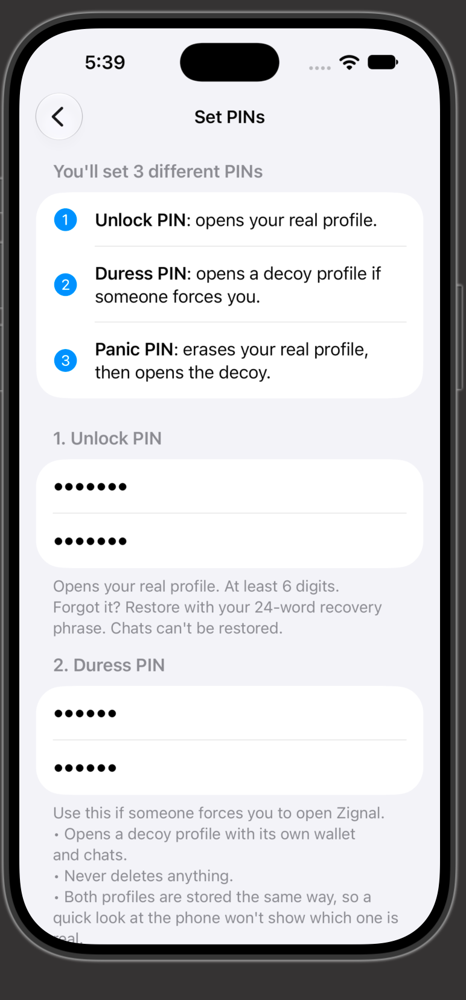
  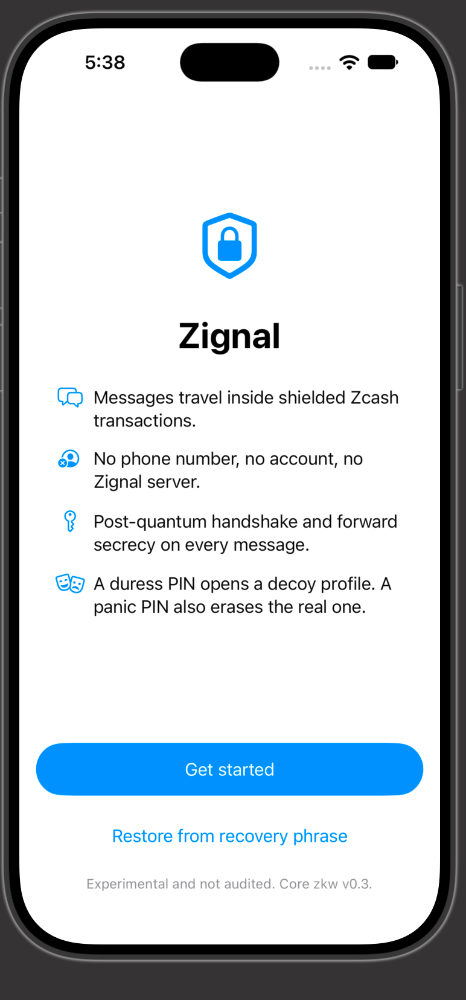
</p>

From the iOS simulator: the welcome screen; the three PINs (unlock, duress for the decoy
profile, panic to erase the real profile); and the panic PIN, which must be confirmed as
something that can't be undone.

<p>
  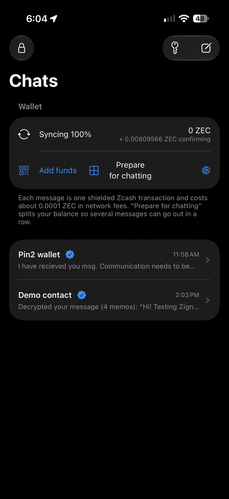
  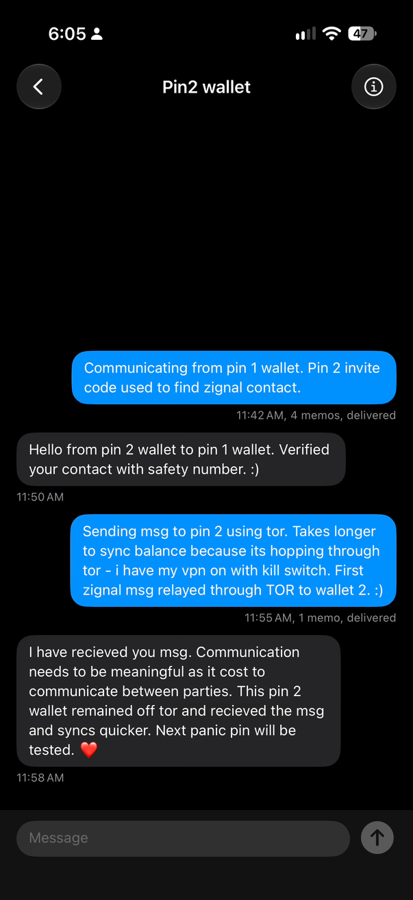
  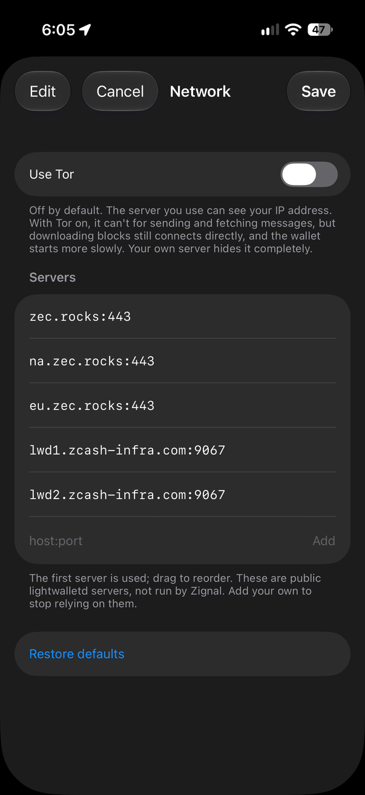
</p>
<p>
  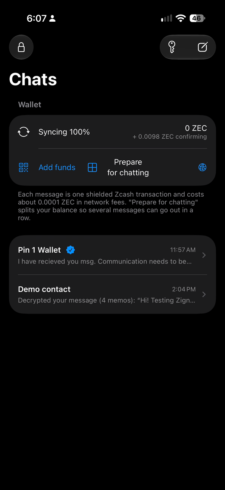
  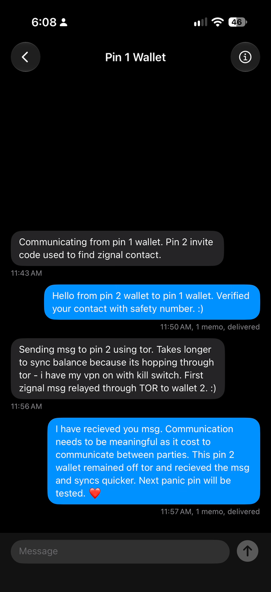
  
</p>

On an iPhone 16 Pro, on Zcash mainnet. The real profile (unlock PIN, "Pin 1") and the decoy
profile (duress PIN, "Pin 2") on the same phone exchange messages as two contacts: each
message is a shielded transaction, shown as delivered once it's in a block. One message went
out with Tor on. Top row: the real profile's chats and wallet, its side of the conversation,
and the network settings (Tor switch and server list). Bottom row: the decoy profile's chats
and wallet, its side of the same conversation, and its wallet syncing.

<p>
  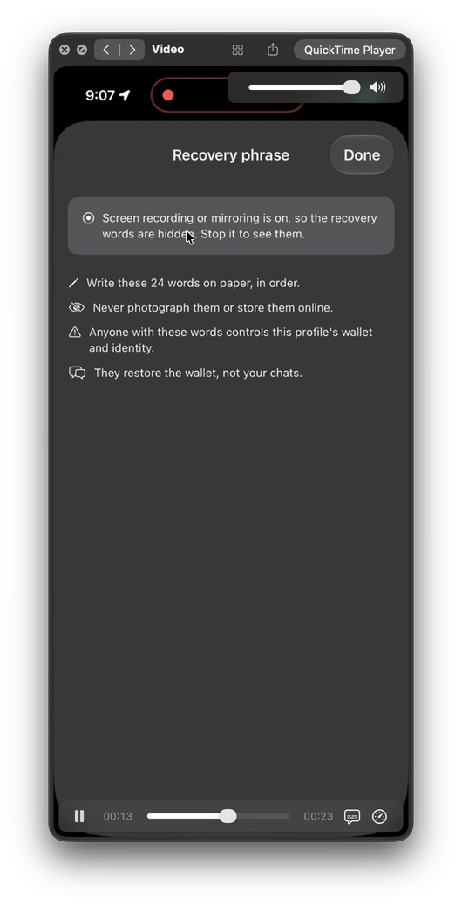
  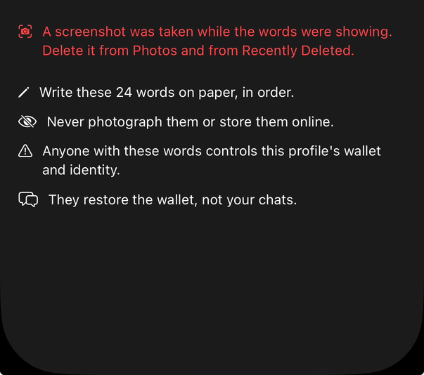
</p>

On `dev`, on an iPhone. Left: a screen recording of the recovery phrase screen, played back on
a Mac: while the recording runs, a notice takes the place of the 24 words. Right: the warning
after a screenshot of the same screen (the words above it are cropped out of this picture).

<p>
  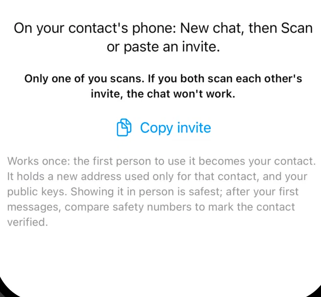
  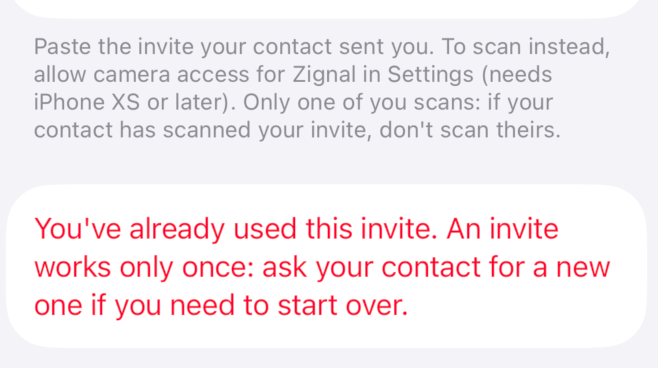
</p>
<p>
  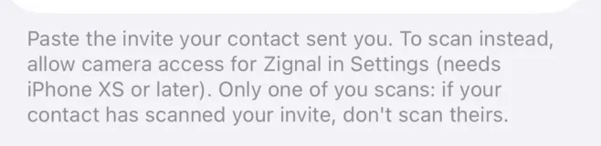
  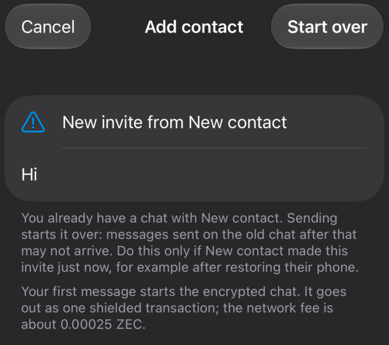
</p>

On `dev`, after the invite changes of November 15. Top left: Show my invite says that only
one of you scans (if you both scan each other's invite, the chat won't work) and that the
invite works once. Top right: Add contact refuses an invite that was already used and says
to ask the contact for a new one. Bottom left: the same note on Add contact, on its own.
Bottom right: a new invite from someone who is already a contact. Add contact warns that
sending starts the chat over, so messages sent on the old chat may not arrive, and to do it
only if the contact made the invite just now; the button says Start over and asks once
more. Taken on the Simulator in dark mode on November 17, so it shows the newer fee text.

<p>
  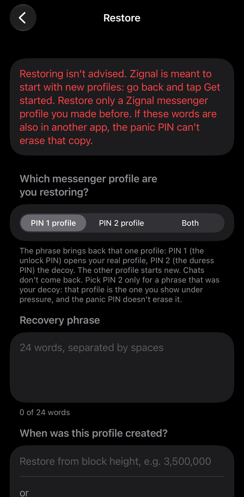
  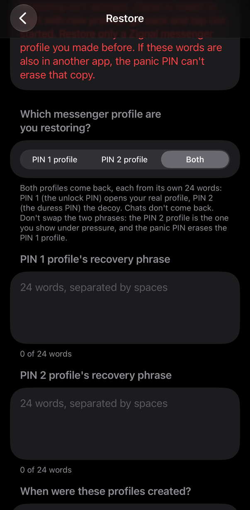
  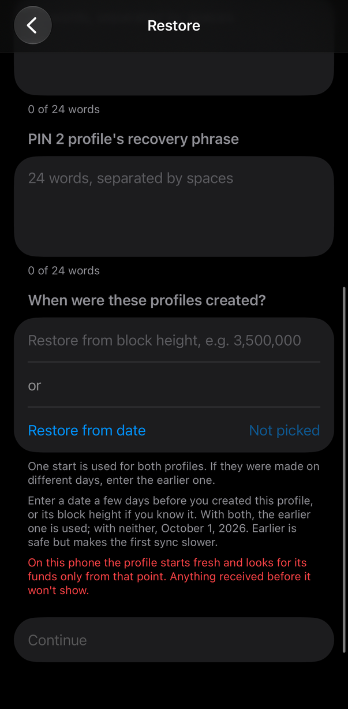
</p>
<p>
  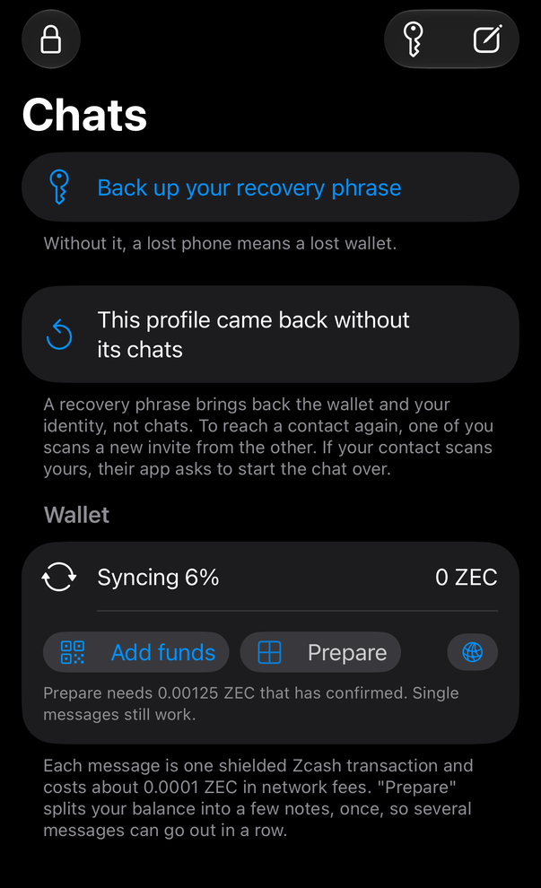
  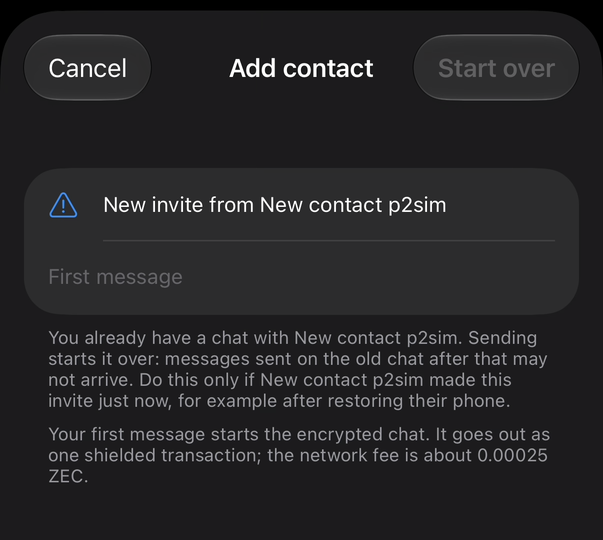
</p>

Restoring, after the changes of November 19 to 21. Top row, on the Simulator: the restore
screen says in red that restoring isn't advised and asks which profile comes back (PIN 1,
PIN 2 or both); with Both, each profile gets its own phrase field; scanning starts from a
block height or a date. Bottom left: a restored profile's chat list says it came back
without its chats and how to reach contacts again. Bottom right, on an iPhone: the contact
scans the restored profile's new invite and is asked before the chat starts over.

## What works today

- **Real messages on mainnet:** each profile has its own Zcash wallet. Messages go out as
  shielded transactions and arrive on the other phone after about one block plus a sync.
- **Invites:** show a single-use QR code on one phone, scan or paste it on the other, and send
  a first message. Each contact gets a fresh shielded address.
- **Delivery status:** sending, sent, delivered (in a block), or not sent, with tap to resend.
  A send cut short by locking the app shows sent while its transaction waits, then delivered
  once it's in a block. Until a first reply has been read in a chat, its messages say
  "sent, waiting for a first reply" instead of delivered.
- **Wallet:** balance and sync status, Add funds (QR code of a shielded address), Prepare
  (splits the balance so several messages can go out in a row, only when that helps), and
  network settings (server list and a Tor switch).
- **NU7 ready:** the wallet library is built from source on the NU7 releases of librustzcash.
- **Messaging core (Rust):** memo envelope, hybrid post-quantum handshake, Double Ratchet,
  inbox, replay protection, encrypted save and restore, three-PIN vault. Checked byte for byte
  against an independent Python reference.
- **Phone security:** an unlock PIN, a duress PIN that opens a working decoy profile with its
  own wallet, and a panic PIN that silently erases the real profile and opens the decoy. A
  24-word recovery phrase per profile, encrypted storage, lock on background, contact
  verification by safety number.
- **Demo contact:** a contact that lives on the phone and needs no ZEC. It runs the same
  protocol (handshake, ratchet, 512-byte memos) but never touches the network.

## How Zignal differs from a Zcash wallet

Wallets such as ZODL, Zingo, Ywallet or Cake are built for payments; their memo is a note
attached to a payment. Zignal is built for messages, and ZEC only pays the network fees.

| | A memo in a Zcash wallet | A Zignal message |
|---|---|---|
| Who can read it | Anyone with the recipient's viewing key, past and future memos alike | A viewing key shows ciphertext and a short header: a second end-to-end layer with forward secrecy |
| Who sent it | No proven sender: anyone can write any name in a memo | Every contact is authenticated in the handshake; safety numbers to compare |
| Quantum | Zcash's note encryption uses classical cryptography | Hybrid post-quantum handshake (X25519 + ML-KEM-768) inside the memos |
| Addresses | You hand out your wallet address | A fresh shielded address per contact; no transparent addresses |
| Conversation | Shown with each transaction | A chat per contact, delivery status, long messages split across memos |
| On the phone | PIN or Face ID | Duress PIN with a working decoy wallet; panic PIN that erases the real profile |
| Wallet features | Full: any address type, transparent funds, often swaps | Deliberately minimal and shielded-only: enough to fund your messages |

Zignal doesn't yet show plain-text memos that other wallets attach to the ZEC they send you;
that's on the roadmap.

## Try it

- **In a browser:** [the Zignal demo](https://zkignal.github.io/zignal-demo/experience.html), a simulation with the app's own screens and text: no wallet, no keys, nothing sent.
- **TestFlight:** private testing started in November 2026, with internal testers invited
  by the developer; a public link comes later. Until then, build from source with Xcode
  (see Build and test); a free Apple ID can install it on your own iPhone.
- **Two iPhones:** on each, set PINs and back up the recovery phrase, then fund the wallet
  with about 0.01 ZEC (Add funds). Received ZEC can be spent after 10 confirmations.
  Receiving messages needs no ZEC: the sender pays the network fee.
  Zignal only uses shielded addresses: to fund it from an exchange, withdraw to a wallet that
  accepts transparent deposits (such as ZODL), shield there, then send to Zignal.
  On one phone: New chat > Show my invite. On the other: New chat > Scan or paste an invite,
  then write a first message. Only one of you scans.
- **One iPhone, on chain:** set up and fund both profiles, then in one profile New chat >
  Show my invite > Copy invite, and in the other New chat > Scan or paste an invite > Paste.
- **One iPhone, no ZEC:** use the demo contact (New chat > Start demo chat) to see the full
  protocol without touching the network.
- **Tested on:** iPhone 16 Pro, iOS 27, Zcash mainnet: invites by paste, messages both ways
  with delivery status, safety numbers, Tor on and off. Later versions were tested again
  November 1 to 20 (see [Since the Zecathon submission](#since-the-zecathon-submission)).

## Repository layout

| Path | What it is |
|---|---|
| `zkw-core/` | Rust messaging core: memo envelope, handshake, Double Ratchet, inbox, persistence, PIN vault |
| `zkw-ref/` | Python reference implementation and test vectors (the protocol's ground truth) |
| `zkw-ffi/` | Swift bindings for `zkw-core` (UniFFI) and the iOS XCFramework build script |
| `ios/Zignal/` | SwiftUI iOS app: `Core/` (storage, vault, sessions, wallet), `UI/` (screens), `Generated/` (bindings) |
| `ios/Zignal/scripts/` | Downloads and hash-checks the Zcash Sapling parameters bundled into the app |
| `vendor/zcash-swift-wallet-sdk/` | Zignal's fork of the Zcash Swift SDK 3.0.0 (MIT): two fixes in the Swift code (and five more changes since the Zecathon submission), and its Rust layer on the NU7 crates, built with `Scripts/build-ios-ffi.sh`. See `ZIGNAL-PATCHES.md` there |

## Protocol at a glance

- **Transport:** one shielded Zcash transaction per message. Each 512-byte memo is a
  zero-value output to the contact's address, so the recipient never receives dust. Long
  messages use up to 15 memos in the same transaction (ZIP-321 multi-output).
- **Envelope:**
  - Fixed 512 bytes: a 25-byte header, up to 402 bytes of text per memo, and random padding.
  - The first byte is `0xFF`, which marks the memo as binary data under ZIP-302, so wallets
    never try to read it as text.
  - Receipts and reactions are indistinguishable from text on the wire.
- **Handshake:** PQXDH-style hybrid of X25519 and ML-KEM-768 (FIPS 203), with signed prekeys.
  The initiator's identity is encrypted inside the handshake.
- **Messages:** Double Ratchet with header encryption (forward secrecy and post-compromise
  security).
- **Contacts:** single-use invites by QR code or paste. Each contact gets its own receive
  address. Contacts verify each other with a 60-digit safety number. The core also supports
  cold contact requests that the recipient must accept; the app doesn't offer them yet.
- **Conversation lookup:** a tag that rotates daily (each UTC day, by the chain's block
  time) instead of any sender identifier. It sits in the memo's readable header (see the
  security notes).
- **Primitives:** X25519, Ed25519, ML-KEM-768, ChaCha20-Poly1305, HKDF-SHA256, Argon2id,
  all from widely used RustCrypto and dalek crates (not every one of them has had an
  independent audit). No custom primitives.

## How the app uses Zcash

- **One wallet per profile.** The real and decoy profiles each have their own wallet, derived
  from that profile's 24-word phrase (BIP-39). The phrase restores the wallet and identity,
  not chat history. Start with new profiles: restoring isn't advised, and the panic PIN
  can't erase a copy of the words kept in another app. A restore brings back the real
  profile (PIN 1), the decoy (PIN 2) or both, each from its own phrase; a profile that
  isn't restored starts new. It takes a block height or a date (with both, the earlier one
  is used; with neither, October 1, 2026) and shows only funds from that point on.
- **Shielded only.** Addresses have a single Orchard receiver, and a new one is made for every
  contact and every invite, so contacts can't link you across chats. No transparent address
  is ever shown or used. Since NU6.3, these payments land in the Ironwood shielded pool.
- **Fees:** standard ZIP-317 fees of 5,000 zatoshis per action: 0.0001 ZEC for a one-memo
  message (two actions) and about 0.00025 ZEC for a chat's first message (four memos and
  the change). From block 3,590,000 (November 19, 2026), the network's
  standard fee is 1,000 zatoshis per action (ZIP 2009). Zignal keeps paying 5,000 until
  its Zcash SDK moves to the librustzcash release with the new fee: still valid, just
  five times more than needed. Fees are public and reveal roughly how many memos a
  transaction carried.
- **Clock:** messages, invites and prekeys use the time of the newest block the wallet has
  scanned, not the phone's date, so a phone with the wrong date still sends messages its
  contacts can read. Until the wallet has nearly caught up with the network, sending a message
  or making an invite waits for it. Making an invite, dropping old prekeys and giving up on a
  transaction that couldn't be read also wait until the phone's clock is within a day of that
  time (see Security notes).
- **Receiving:** after each sync, new transactions are read in chain order, each at its own
  block time, so a message read days later still finds its chat.
- **Delivered** means the transaction is in a block. There are no read receipts, which would
  cost the reader a transaction and reveal when they read. So it doesn't show that the
  contact's phone could read the message: until a first reply has been read in a chat, its
  messages say "sent, waiting for a first reply".
- **Servers:** public lightwalletd servers by default (zec.rocks, Stardust and Cake Wallet;
  only the first is used), editable in the app, including your own. Tor is on by default
  for new profiles and can be switched off per profile.
- **Sapling parameters** are bundled in the app and checked against pinned hashes at build
  time, so the app never downloads them.
- **NU7:** the SDK's Rust library is built from source on librustzcash's NU7 releases, so the
  wallet follows the network upgrade at block 3,543,405. From NU7 it builds version 6
  transactions with a 120-block expiry, and addresses stay revision-0 `u1…` addresses. EIP-681
  parsing and the pool migration, which Zignal doesn't use, are left out.
- **Patched SDK:** the app builds against Zignal's fork of the Zcash Swift SDK 3.0.0 in
  `vendor/`. Its Swift code fixes two bugs in the released SDK
  that kept a locked wallet working in the background until the app was closed: stopping a
  wallet while it was syncing could be undone by the SDK's own retry timer, and every sync
  started another mempool watcher that stopping didn't end (each kept a server connection
  open and could recreate a deleted wallet database). With the fixes, a stopped wallet stays
  stopped. Details in `vendor/zcash-swift-wallet-sdk/ZIGNAL-PATCHES.md`; both are reported
  upstream in [zcash/zcash-swift-wallet-sdk#2012](https://github.com/zcash/zcash-swift-wallet-sdk/issues/2012).
  Since the Zecathon submission, five more changes: the SDK's per-wallet record of its
  witness repair is kept in the wallet's own folder instead of the app's preferences, a
  server switch no longer restarts a wallet the app has stopped, the wallet never asks the
  server about its transparent addresses, a recent checkpoint (block 3,565,000, after NU7)
  shortens restores from a recovery phrase, and the wallet can read the time of the newest
  block it has scanned (the clock for messages and invites).

## How the app protects data on the phone

**PINs**
- Your unlock, duress and panic PINs each open one slot in a fixed-size, three-slot vault
  (Argon2id, 64 MiB). Each attempt runs Argon2id once and then tries every slot, so all three
  PINs take the same time and nothing on disk says which slot is which.
- The vault is stored in the Keychain (this device only, never synced), encrypted to a P-256
  key in the iPhone's Secure Enclave: ECDH with a fresh ephemeral key, HKDF-SHA256, then
  AES-GCM. The Secure Enclave key never leaves the chip and works only on this phone, while
  it's unlocked, for this app. So a copy of the Keychain taken off the phone can't be opened,
  and the PINs can't be guessed offline from it.
- An install from before this change seals its vault the first time it opens and its device
  key at the first unlock, without asking for a PIN. Each old copy is deleted only after the
  sealed one has been read back and opened. If the seal can't be made, the app keeps using the
  old copy and tries again the next time it reads it; it doesn't show this yet.
- 5 wrong PINs are free. Past them, each try waits 30 seconds, doubling up to 1 hour, shown
  as a live countdown. Each try is counted in the Keychain before the PIN is checked, so
  force-quitting the app doesn't reset the count.
- **What starts the count over: 2 hours with no wrong PIN.** Unlocking doesn't, with any of
  the three PINs: a PIN that opens a profile takes back only its own count, so earlier wrong
  PINs still count. The lock screen says so under the countdown. For example: 4 wrong PINs,
  then the duress PIN opens the decoy; Lock; PIN 1 opens the real profile; the next wrong PIN
  (the 5th) waits 30 seconds, the one after it 1 minute, then 2 minutes, and so on, until 2
  hours pass with no wrong PIN.
- Why not clear the count on a right PIN: someone who knows the duress PIN could then guess 4
  PINs, open the decoy, and start again, without ever waiting. With the 2-hour rule they get
  5 free guesses and a few more after growing waits, then must stop for 2 hours: at most
  about 106 guesses a day, so trying every 6-digit PIN would take about 25 years. Clearing
  it on the real PIN only isn't possible either: the vault doesn't record which PIN opens
  the real profile, so the decoy can't be told apart from it.
- A counter that can't be read counts as no free tries left.
- The wait and the 2 hours are measured on `CLOCK_MONOTONIC_RAW`, which keeps counting while
  the phone sleeps and can't be set, so changing the date or time doesn't shorten them. A
  restart starts them over but never shortens them.

**Duress and panic**
- The duress PIN opens a decoy profile that looks and works like a normal one, with its own
  wallet. It never starts a wipe; it only finishes one that the panic PIN started.
- The panic PIN is a last resort. It silently destroys the real profile (its PIN slot, its
  saved data, its wallet files and the Zcash SDK's settings for that wallet), then opens the
  decoy as usual. The clean-up runs once the decoy is on screen, so a panic unlock doesn't
  wait for it, though it saves the profile files once more than other unlocks (see
  [Security notes](#security-notes-and-known-limitations)). The clean-up waits for any wallet
  that is still stopping; files written back later, for example by a wallet that was still
  starting, are found and deleted at a later unlock (below). The phone keeps the same profile
  file names at the same size: the real profile's file is overwritten with filler under
  its own name, as every save rewrites every file. The wiped profile's wallet files are
  deleted without a replacement, which leaves a trace (see
  [Security notes](#security-notes-and-known-limitations)).
- Until the wipe is confirmed finished, the decoy profile's own sealed data records that it
  is under way. If the app is closed or the phone switched off before then, the next time
  the decoy opens, with the duress or the panic PIN, the wipe is finished. It counts as
  finished only after two unlocks in a row find nothing of the wiped profile left.
- Every successful unlock stores the vault again under a new seal, so its Keychain item
  changes on every unlock, not only when the panic PIN is used.
- Changing the server or Tor can take a few seconds. If the profile locks meanwhile, the
  wallet is stopped again when the change finishes (a server switch used to restart it),
  and a panic wipe waits for the change like it waits for a wallet that is stopping.
- On the recovery phrase screen, the panic PIN counts as a wrong PIN, like the other
  profile's PIN: it never shows a phrase there and never wipes there.
- The app never shows which profile is open.

**Storage**
- Each profile's data is sealed under that profile's own key, inside a second layer sealed
  under a random 32-byte device key. The device key is stored in the Keychain sealed by the
  Secure Enclave, the same way as the vault.
- The Zcash SDK keeps one setting per wallet (the app version for which it last repaired
  that wallet's notes). It is a file in the wallet's own folder, which isn't backed up and
  is deleted with the wallet, and no longer an entry in the app's preferences, which go
  into device backups. The app deletes the old entries each time it starts.
- Every save rewrites all profile files to one common size with the same timestamps, so the
  files change together whichever profile is in use. They're written in a random order:
  each write makes a new file, so a fixed order could show which profile was saved.
- Data is saved before anything is sent, so a crash can't cause message keys to be reused.
- Profile files and wallet files use complete data protection and are excluded from device
  backups. Wallet file names are derived from each profile's key and don't say which profile
  is which.
- If a restored phone backup brings back the PIN vault (it's in the Keychain, this device
  only), the profiles' files and wallets still aren't there: each profile opens empty and
  asks for its wallet's block height or date, then looks for its funds from there. Chats
  can't come back.

**Screen and input**
- The app locks when it goes to the background. Locking stops the profile's wallet: no more
  syncing, network traffic or file writes for that profile until it is unlocked again.
- A cover window hides it, including open sheets and alerts, in the app switcher.
- Third-party keyboards are blocked, and the message box has autocorrect off.
- Received text is shown verbatim, never rendered as Markdown or links.
- Copied invites, addresses and message text stay on this phone (no Universal Clipboard)
  and expire after 60 seconds: iOS removes them then. The Lock button and the next unlock
  remove Zignal's copy sooner, so a copy made in one profile isn't left for the other, also
  after the app was ended or a trip to the Home Screen: the Keychain keeps the pasteboard's
  change count and the expiry time (never the text) until the next unlock or lock. Within
  those 60 seconds they clear the whole pasteboard, a copy made in another app included
  (see [Security notes](#security-notes-and-known-limitations)). Going to the background
  keeps the copy, so an invite or an address can be pasted into another app; until it
  expires, any app can read it then. Share invite and Share address send it straight to the
  app you pick, without the pasteboard (the share sheet has no Copy). Message text and the
  wallet address can't be selected; copy them with Copy (touch and hold a message).
- The recovery words appear only once the app knows the screen isn't being recorded,
  mirrored or shared, so a recording that's already running doesn't catch them.

**Logging and network**
- The app has no logging and no analytics, and the Zcash SDK's logging is turned off. Debug
  builds run from Xcode print two kinds of lines to Xcode's console, to check that Zignal's
  copy is cleared and to time unlocks: counts and durations, never text, keys or what was
  copied.
  TestFlight and App Store builds don't contain them.
- Its only network traffic is the wallet talking to the server you choose.

## Network privacy: Tor, a VPN or your own server

Zcash hides sender, recipient and amount on chain. Who connects to the server, from which IP
address and when, is a separate problem, and the app can only solve part of it.

**What the server sees**
- **Which transactions you read:** to read a message, the wallet asks the server for its
  transaction by ID (lightwalletd's `GetTransaction`), and it checks the messages you send
  the same way until they are mined. So the server learns which transactions carry messages
  for you, with Tor on or off; the messages stay encrypted. Hiding this is on the
  [roadmap](#roadmap-after-the-zecathon).
- **Tor off:** the server you use sees your IP address with every request:
  the transactions you send, the ones it fetches for you to read messages, and the blocks you
  download. One server operator often sees the sender's IP address submit a transaction and
  the recipient's IP address fetch it, which shows who writes to whom and when, even though
  the messages stay encrypted.
- **Tor on (the default for new profiles):** sending, fetching transactions, checking the
  server and reading the chain tip go over Tor, so the server sees a Tor exit instead of
  your IP address. Syncing still connects directly: downloading blocks, tree states and
  subtree roots, which are the same for every wallet. The server learns that you use Zcash
  and when you sync. It doesn't see your IP address on the transactions the wallet fetches
  over Tor, but it may link them to your sync by timing: the wallet fetches them right after
  it has downloaded, directly, the blocks that hold them. On a quiet server, or after a long
  time offline, such a fetch can stand out. Tor depends on no single company, but it's
  slower.
- **Profiles made by earlier versions** keep the setting they had: Tor off unless it was
  turned on. Turn it on under Network.
- **No wallet identifier:** until November 12, the wallet also sent all of its transparent
  addresses on every sync, directly even with Tor on, which let the server recognize the
  same wallet across IP addresses, VPN exits and Tor. Zignal uses shielded addresses only
  and no longer asks about transparent ones.
- **Where a sync resumes:** each sync downloads blocks, directly even with Tor on, from where
  the wallet's last sync stopped. A server that sees one sync stop and a later one start at
  the next block can guess they're the same wallet, across IP addresses and VPN exits. It
  doesn't learn from this which transactions are yours.
- **Your own server:** point Zignal at a lightwalletd you run, and no third party sees your
  requests. Zebra 6.4 and later can also serve wallets itself, with an experimental
  lightwalletd-compatible server (`rpc.lightwalletd_listen_addr`), so a separate
  lightwalletd isn't needed. Zignal hasn't been tested with it yet.

**Compared with Zodl's relay (November 2026).** Zodl 3.20 sends its wallet requests through
Oblivious HTTP: a relay run by Cloudflare or Fastly sees your IP address but not the request,
and ZODL's gateway sees the request but not your IP address. Linking the two takes both
companies working together. With Tor on, Zignal gets the same protection for sending and
fetching, the requests that show which transactions are yours, in a different way.
Syncing (block downloads) isn't covered yet. Zignal doesn't use ZODL's relay code: it is licensed
AGPL-3.0-only, with no permission for App Store distribution. Asking ZODL whether Zignal may
use it is on the [roadmap](#roadmap-after-the-zecathon).

**Using a VPN (recommended, with a kill switch and a no-logs provider).** Privacy-focused
Zcash users should consider a VPN as well as Tor. Here is what changes.

| Who | Without a VPN | With a VPN and a kill switch |
|---|---|---|
| Your internet provider or the Wi-Fi owner | Sees that you connect to a Zcash server, and when | Sees only an encrypted connection to the VPN |
| The light server | Your IP address with every send, fetch and block download | The VPN's address for everything, block downloads included |
| The VPN company | Not involved | Your IP address, which server you use, when and how much. Not the content: the connection to the server is encrypted |
| The blockchain, a viewing-key holder, someone holding your phone | No change | No change |

- **Turn on the VPN's kill switch.** Zignal's wallet reconnects by itself. If the VPN drops
  without a kill switch, the next sync or send leaves from your real IP address, and one such
  request is enough to link the VPN's address to you. On iPhone, choose a VPN whose kill
  switch sends all traffic through the VPN (often called "include all networks" or "block
  connections without VPN"), and check it's still on after every VPN app update.
- **Choose a no-logs provider, and check the claim.** A VPN sees your real IP address next to
  every server you talk to, so its records matter more than anyone else's. Look for:
  - a no-logs policy that an independent firm has audited recently, with the report
    published;
  - a record of what the company handed over when it received legal requests (a transparency
    report, or a court case where nothing was there to hand over);
  - payment without your name: cash or cryptocurrency, an account number instead of an email
    address;
  - servers that keep nothing on disk (RAM-only), and a jurisdiction you're comfortable with.

  "No logs" in an advert proves nothing; an audit and a track record are evidence, not proof.
- **Use a shared address, not a dedicated one.** Many users behind the same VPN address hide
  each other. A dedicated or static address becomes a fixed identity the server can follow.
- **What a VPN doesn't do.** Every request from your phone comes from the same VPN address,
  so the server can still group your own requests together ("this user sent A, fetched B,
  synced at 9 PM") without knowing who you are. A VPN company that keeps logs, or is ordered
  to, and a server operator who cooperates could link you. A VPN changes nothing on the
  blockchain, nothing a viewing-key holder sees, and nothing for someone holding your
  unlocked phone.
- **The strongest setup today: a VPN with a kill switch, plus Tor on in Zignal.** Your
  internet provider sees only the VPN. The VPN sees only Tor traffic for sends and fetches.
  The server sees Tor for sends and fetches and the VPN's address for syncing. No
  single party sees your IP address together with your transactions. The cost is speed:
  syncing and sending are slower.
- **Your own server at home:** a kill switch that blocks local network access also blocks a
  server on your home network. Either allow local network access in the VPN app, or reach
  your server through the VPN.

## Build and test

Requirements: macOS with Xcode 27, an iPhone on iOS 17 or later, Rust (`rustup`), and
Python 3.11+ with `cryptography` (reference only). The app runs on iOS 17 or later; the
test targets are set to iOS 27, so the tests need an iOS 27 Simulator or iPhone.

```bash
# First time only: download the Rust dependencies. The build script then works offline.
(cd zkw-core && cargo fetch) && (cd zkw-ffi && cargo fetch)

# Rust core tests, including byte-for-byte checks against the Python reference
(cd zkw-core && cargo test)

# Python reference tests
(cd zkw-ref && python3 -m unittest -v)

# Swift bindings + iOS XCFramework, plus the binding tests. The library keeps no file paths
# from the build machine; the script stops if any remain.
(cd zkw-ffi && ./build-ios.sh)

# Zcash Sapling parameters (about 51 MB from download.z.cash, size and hash checked)
bash ios/Zignal/scripts/fetch-sapling-params.sh

# The Zcash SDK's Rust library (libzcashlc) for iPhone and the Simulator, on dev and nu7.
# Needs Rust 1.97 or newer. The first build downloads the crates and takes a few minutes.
rustup target add aarch64-apple-ios aarch64-apple-ios-sim   # Intel Mac: x86_64-apple-ios
vendor/zcash-swift-wallet-sdk/Scripts/build-ios-ffi.sh
```

`build-ios-ffi.sh` installs the library in `vendor/zcash-swift-wallet-sdk/LocalPackages/`
(git-ignored), which the SDK's `Package.swift` links. There is no fallback to ECC's prebuilt
binary, which stops working at NU7: without this step, Xcode reports the missing library.
Run it again after pulling changes to `vendor/`.

Then open `ios/Zignal/Zignal.xcodeproj`:
- Cmd+U runs the 144 app tests and the 2 UI tests. They cover:
  - PIN rules and the wrong-PIN wait (the count starting over only after 2 hours with no wrong
    PIN, never with an unlock or a restart, and an unreadable counter), the three-PIN vault
    (duress and panic), the panic PIN never showing a recovery phrase, and a timing test for
    each unlock step;
  - the Secure Enclave seal (round trip, tampering, the wrong key or label), moving an older
    install's Keychain items under it, a move cut short, and a sealed vault winning over an
    older plain copy after a panic wipe, and a new seal each time the vault is stored;
  - the wrong-PIN wait after a restart and with state saved by older versions;
  - storage encryption and tamper checks, the random write order, what a silent wipe leaves
    behind (the same file names), a wipe cut short being finished later with the usual two
    profile files, and a wipe counted finished only after two clean unlocks;
  - recovery phrases, and the demo chat across restarts;
  - payment request encoding and address checks, invite parsing against a real invite from
    the core, copying an invite as text and clearing it at lock and at the next unlock,
    refusing an invite used before, and asking before a chat with an existing contact
    starts over;
  - memo filtering, wallet settings and messages (Tor on for a new profile, kept as it was
    for one saved by an earlier version), the default servers, where a restore starts
    scanning, waiting for stopped wallets and for settings changes, and removing the SDK's
    old entries from the app's preferences;
  - when Prepare splits or waits; interrupted sends found in the wallet, sent again as the same
    transaction and shown as "Checking" until the wallet has looked (saying so when that
    takes long); and reading a chat's first message before the rest;
  - the chain's time as the clock for sending, invites and retries, and prekeys stamped by
    a phone's date far ahead being replaced;
  - the pasteboard mark that outlives the app being ended (a count and a time, never the
    text, and an expired one ignored), the 60-second expiry, and a share sheet without Copy;
  - a profile whose file isn't on the phone asking for its wallet's block height or date,
    a restore from a block height, a date or both (the earlier one wins, heights checked,
    October 1, 2026 when neither is given), a phrase restored as the decoy profile, both
    profiles restored from their own phrases, and a chat put back after a save that failed;
  - the two clocks that must agree before prekeys are dropped (a chain time 22 days ahead
    leaves an invite working), a chat waiting for its first reply, and Zignal's copy
    cleared within its 60 seconds even when the pasteboard's count has moved on;
  - the privacy manifest and the recent checkpoint the app ships.
- The Zcash SDK is a local package in `vendor/`. On the first build Xcode downloads its Swift
  dependencies (grpc-swift, SQLite.swift).
- Cmd+R runs the app. The wallet connects to the first server in its list.

## Security notes and known limitations

To report a vulnerability privately, see [SECURITY.md](SECURITY.md).

- **Not audited.** Treat as experimental software. Friends of the project reviewed `dev` in
  November 2026; what they found is fixed, listed below, or planned.
- **On chain:** Zcash shielded transactions hide sender, recipient and amount. Your IP address
  and timing are a separate problem.
- **Network privacy:** with Tor off, the server you use sees your IP address and which
  transactions are yours: the ones you send and the ones it fetches for you to read. That
  links who messaged when to an IP, even though the contents stay encrypted. Tor is on for
  new profiles; a profile made by an earlier version keeps the setting it had. The
  Zcash SDK's Tor covers sending and fetching; syncing (blocks, tree states, subtree roots)
  still connects directly, and the wallet sends no transparent addresses at all. Your own
  server removes the third party entirely. A VPN with a kill switch and a no-logs provider,
  together with Tor, covers the rest (see
  [Network privacy](#network-privacy-tor-a-vpn-or-your-own-server)).
- **Transparent addresses:** Zignal never gives out a transparent address and doesn't look
  them up. ZEC sent to one of the wallet's transparent addresses isn't shown; restoring the
  24 words in a full Zcash wallet recovers it.
- **Tor and certificates:** with Tor on, the server's certificate is checked by the Zcash SDK's
  own code, not by iOS. The Zecathon build (`zecathon-final`, SDK 3.0.0) still trusts eight
  certificate authorities whose keys leaked in October 2026. iOS itself already blocks them,
  so Tor off is not affected. Someone holding one of those keys and sitting between Tor and
  the server could pose as the server: see which transactions you fetch, hide or fake server
  data, block sends. They can't take funds or read messages. **Fixed on `dev` and `nu7`**,
  which use `rustls-webpki` 0.103.16 and `webpki-roots` 1.0.11.
- **A send that didn't finish:** after a lock or a crash, the message shows "Checking whether
  it went out…" until the wallet has looked, then "sent" while its transaction waits to be
  mined. If it never reached the server, the Zcash SDK resends it every few minutes while the
  app is open, until it's mined or expires (about 50 minutes). When a send fails outright,
  "Tap to send again" sends the same transaction if the wallet still holds it, so a message
  is paid for once. "Checking" waits for the wallet to catch up with the network; if that
  takes more than a minute (no server reached, or a long sync), it says so. Zignal keeps
  trying.
- **Sending again days later:** a message sent again two or more UTC days after it was
  written still carries the conversation tag of the day it was written, so the contact's
  phone doesn't read it, while this phone shows it delivered. Until the fix (see Roadmap),
  write such a message again instead.
- **The chain's time comes from the light server:** Zignal's clock is the time in the newest
  block the wallet has scanned, and Zignal doesn't check block times against another source.
  A server reporting wrong times can make the messages you send unreadable for the contact
  (they carry the wrong day's tag) while this phone shows them delivered, and can keep this
  phone from reading messages that arrive in blocks whose times it misreports. When the
  chain's time and the phone's clock are more than a day apart, the chat list says so. Until
  they agree again, no invite can be made and nothing that can't be undone happens: old
  prekeys aren't dropped (so prekeys aren't rotated either) and no unread transaction is
  given up on. Sending isn't blocked. If the phone's date is wrong the same way as the
  server's time, nothing notices. Use servers you trust, or your own.
- **A contact who restored their profile:** a recovery phrase brings back the wallet and the
  identity, not chats. What you send them on the old chat still shows delivered, and their
  phone can't read it; nothing tells your phone that they restored. Their app says, until it
  has a contact, that one of you has to scan a new invite from the other. "Delivered" only
  means the transaction is in a block: a new chat's messages say "sent, waiting for a first
  reply" until something from the contact has been read.
- **Zignal's copy and other copies:** while Zignal's last copy may still be on the
  pasteboard (its 60 seconds), the Lock button and the next unlock clear the whole
  pasteboard. An iPhone changes the pasteboard's change count by itself while Zignal is in
  the background, so Zignal can't tell its copy from one made elsewhere since: something
  you copied in another app within those seconds is cleared too. In the background the
  copy stays, so an address or an invite can be pasted into another app; until it
  expires, any app can read it then.
- **The camera:** the Add contact screen turns the camera off as soon as it has read an
  invite, scanned or pasted, before you type the first message; it's on only while you
  scan. Zignal doesn't record or keep what the camera sees. Paste works without the camera:
  if you prefer, turn off camera access for Zignal in the Settings app and paste invites
  instead.
- **Message length shows in the fee:** each memo adds an output, so the fee (and the number of
  actions in the transaction) shows roughly how long a message was. Padding to fixed sizes
  would hide it at a higher fee; that's on the roadmap.
- **Remaining RustSec advisories** in the SDK's dependencies (checked November 17, 2026):
  - through arti (the Tor client, on for new profiles), with no compatible fix yet: `rsa`
    (RUSTSEC-2023-0071; the Marvin attack targets private-key decryption, and a Tor client
    only verifies signatures) and `crypto-bigint` (RUSTSEC-2026-0387; used for SSH key
    parsing for onion services, which Zignal doesn't use);
  - `libsqlite3-sys` 0.35 (RUSTSEC-2026-0459), the SQLite built into the SDK's Rust code:
    opening a database together with a crafted `-wal` file can return uninitialized memory.
    Only the app writes these databases, inside its own container. The fix needs newer
    releases of librustzcash and arti;
  - `rustix` 1.1.4 (RUSTSEC-2026-0486, informational): unsound when an extended-attribute
    call gets an empty buffer. It comes in through `tempfile`; Zignal makes no such call.
    Version 1.1.6 fixes it and is a compatible update; it isn't in the lock yet;
  - `chrono` and `humantime` are marked unmaintained (RUSTSEC-2026-0543 and
    RUSTSEC-2026-0542, informational): no known vulnerability;
  - `bincode` 2.0.1 and `paste` 1.0.15 are marked unmaintained too (informational);
  - in `zkw-ffi`'s own lock file, `basic-toml` 0.1.10 (RUSTSEC-2026-0374) and `bincode` 1.3.3
    (RUSTSEC-2025-0141) are marked unmaintained (informational): no known vulnerability.
    Both come in through UniFFI, which generates the Swift bindings.

  Details in `vendor/zcash-swift-wallet-sdk/ZIGNAL-PATCHES.md`.
- **Tor library version:** the Tor client (arti 0.43) dates from around June 2026. Arti 2.8.0
  (November 3, 2026) fixes several low-severity security issues, but librustzcash's NU7
  releases pin arti 0.43, so an update needs a new librustzcash release. Requested upstream in
  [zcash/librustzcash#3246](https://github.com/zcash/librustzcash/issues/3246). Tor is on by
  default for new profiles now, so this update matters more.
- **Open app only:** messages arrive while the app is unlocked and synced. There are no push
  notifications, which would need a Zignal server. What arrived is marked new on the chat
  list, and optional reminders (notifications your iPhone makes, always the same words:
  every day at a time you pick, or after a length of time you pick) can nudge you to open
  the app; they can't know whether anything arrived.
- **Cost and delay:** each message costs a normal network fee and arrives after about one block
  plus a sync.
- **Wallet files:** the Zcash SDK stores each wallet in a plaintext database, protected by iOS
  file protection. A forensic image of an unlocked phone could tell which wallet has history.
- **What a viewing key still shows:** each memo starts with a short header in the clear: the
  Zignal marker and version, the message type (for example, that it starts a chat), a
  conversation tag that stays the same for a chat through a whole UTC day, and how many bytes
  of the encrypted message it carries. So anyone with a profile's viewing key, or a copy of
  its wallet database (which keeps its memos), can see that Zignal is in use, group a day's
  messages by chat, count them, see how long each one is, and see when a chat started. A
  chat's first message also carries its invite's ID, so someone who saw that invite can match
  the two, and the IDs of the inviter's prekeys: counters that grow by two each week, so
  they show roughly how long the inviter's profile has existed. Message text and who your
  contacts are stay encrypted. Random prekey IDs, and encrypting more of the header, are on
  the roadmap.
- **Seed in memory:** while a profile is unlocked, its wallet seed stays in memory to sign
  sends. Swift can't reliably wipe memory after lock; the Rust core wipes its own copies.
- **PIN strength:** with a copy of the Keychain, PINs can only be tried on the phone itself,
  through the app: about a second per try, plus the wrong-PIN wait. Someone who can run their
  own code inside Zignal on an unlocked phone (through an iOS exploit) could open the seal
  and then guess offline as before: a 6-digit PIN within hours. Use 8 or more digits for real
  use. Each extra digit multiplies the work by 10, and Zignal accepts up to 16.
- **Decoy realism:** a decoy profile is only convincing if it's used now and then and holds
  a little ZEC.
- **Panic PIN:**
  - It can't be undone. The real wallet's funds come back only with its 24-word phrase, so
    keep that phrase off the phone; chat history can't be recovered.
  - Choose the three PINs several digits apart. An unlock PIN mistyped into the panic PIN
    erases the real profile, and one mistyped into the duress PIN opens the decoy. The app
    doesn't check this yet.
  - Someone who saw your unlock PIN work before will notice that it stops working.
  - It erases only what's on this phone. Transactions stay on chain (unreadable without the
    keys), the server may keep its own records of your IP address, your contacts keep their
    copies, and the app itself stays installed.
  - Wiping data while being forced to unlock may carry legal risk where you live.
  - A wipe is detectable by someone who knows how Zignal works: two wallets' files normally
    exist, and afterwards only one does.
  - If the app is closed or the phone switched off during a wipe, the real wallet's database
    stays on the phone (its seed is already gone) until the decoy opens again, with the
    duress or the panic PIN, which finishes the wipe. Only if the app stops in the instant
    between wiping the vault slot and recording that a wipe is under way does it stay until
    the panic PIN is entered again.
  - Opening the decoy never waits for the clean-up: a wallet that is still stopping is
    waited for in the background, after the decoy is on screen.
  - Before the decoy shows, a panic unlock saves the profile files once more than other
    unlocks do, and any profile takes longer to open the more it holds. Every unlock now
    takes at least 0.75 seconds from the accepted PIN to the profile showing, which covers
    both as long as opening stays under that. It hasn't been measured on an iPhone with a
    large profile yet; removing the extra save is still planned.
- **The panic PIN leaves a trace:** it destroys the real profile and keeps the same number of
  profile files, but the real profile's wallet files are deleted without a replacement.
  Someone examining the phone's files can then see that only the open profile has a wallet.
  Many phones look like that anyway (a profile's wallet only appears once it's opened), but
  next to a decoy wallet created minutes earlier it can suggest a wipe. A fix is planned.
- **PINs against a forensic copy:** the vault and the device key are sealed by a key in this
  iPhone's Secure Enclave, so a copy of the Keychain taken off the phone can't be opened
  anywhere else, and the PINs can't be guessed offline from it. Tools that can run code as
  Zignal on the unlocked phone could still open the seal (see PIN strength). Debug builds on
  a device without a Secure Enclave (some Simulators) keep the sealing key in the Keychain
  instead; release builds refuse to set up there.
- **Wrong-PIN wait after a restart:** restarting the phone during a wait can start the wait
  over. It never ends it early.
- **Recovery words on screen:** they're hidden while the screen is recorded, mirrored or
  shared. iOS can't block screenshots or stop a camera pointed at the screen: after a
  screenshot the app warns you to delete it, and nothing can detect a camera.
- **One phrase, two roles:** a profile's 24-word phrase is both its wallet seed and its
  messaging identity. Anyone with the words can spend the funds and pose as you to your
  contacts with the same safety number, though they can't read past messages.
- **First message of a chat:** forward secrecy for the very first message rests on the weekly
  rotation of signed prekeys; there are no one-time prekeys yet. From the first reply on, the
  Double Ratchet applies.
- **Unused invites:** an invite stops working after two to three weeks: by then the keys it
  carries have been replaced. Its ID, though, stays valid until it's used: someone who
  holds an old unused invite and any newer invite of yours can still start a chat from the
  old one, months later. Whoever uses an invite first becomes that contact. Show an invite
  only to the person it's for, and compare safety numbers before trusting a chat. Expiry
  for the ID is on the roadmap.
- **Starting a chat:** only one person scans. If both scan each other's invite before either
  phone has read the other's first message, the chat breaks on both phones without a sign;
  the invite screens say so, and a fix needs the next invite format. An invite used before
  is refused, and a new invite from an existing contact asks before starting the chat over.
  A used invite whose address or ID was edited isn't recognized as used and asks too: the
  next invite format signs both.
- **Spam:** anyone with one of your addresses can send you contact requests (not shown in the
  app yet) or partial messages for the price of a fee. Zignal's core keeps at most 32 requests
  and 64 incomplete messages, dropping the oldest first.
- **NU7:** NU7 activated on mainnet at block 3,543,405 on November 6, 2026, at 02:34 UTC.
  - The Zecathon build (`zecathon-final`) uses SDK 3.0.0's prebuilt library, so it
    stops syncing and can't send after that.
  - ECC's SDK ends support at NU7. Its final release, 4.0.0, doesn't include NU7, and
    development continues in the ZODL Swift Wallet SDK (AGPLv3).
  - Zignal chose to keep its own MIT fork in `vendor/`: SDK 3.0.0's Swift code with Zignal's
    two fixes, and its Rust layer rebuilt on librustzcash's NU7 releases.
  - That update is on `nu7`, changing only the SDK in `vendor/` (and the README), and on
    `dev`. It is tagged `zecathon-nu7` and was tested on mainnet after activation.
  - The light server you use must run NU7-ready software (Zebra 7.0.0 or later), or syncing
    stops until it does.

## Roadmap (after the Zecathon)

- **TestFlight:** private testing started in November 2026 (tag `private-testing-1`); a
  public link comes later.
- **NU7 compatibility:** done on `nu7` and `dev`, tagged `zecathon-nu7` after testing past
  activation (see [Since the Zecathon submission](#since-the-zecathon-submission)).
- **Length privacy:** an option to pad messages to fixed memo counts, so the fee doesn't show
  how long a message was.
- **Prebuilt SDK library:** publish the built library with each release, so building the app
  doesn't need Rust.
- **Notes from other wallets:** show the text memos that other wallets attach to the ZEC they
  send you, read-only and labelled "sender not verified", with no links.
- **Send to other shielded wallets**, with a plain memo.
- **Import a wallet** into either profile from its 24-word phrase, with a clear warning that
  an existing wallet's history becomes linked to your messaging addresses.
- **Contact requests:** start a chat with any Zignal user from their shielded address, with a
  requests inbox, accept and block, and a small fee for strangers. QR invites stay for meeting
  in person and verifying each other.
- **Hardening from our review:** one-time prekeys for the first message, show when a contact
  resets a chat, and let users revoke unused invites. Hiding the recovery words during screen
  capture and limiting stored contact requests are done on `dev`.
- **From the November reviews:** a panic wipe that leaves the wallet folder looking the same;
  PIN rules that keep the three PINs apart; a panic unlock without the extra save; a notice
  when the Secure Enclave seal can't be made; a memo header that shows less to a viewing key.
  The PIN vault sealed by the Secure Enclave, a wrong-PIN wait that doesn't follow the
  clock, finishing a panic wipe that was cut short, the fixes of November 11 and 12, and
  wrong-PIN tries that unlocking doesn't give back are done on `dev`.
- **From the November 15 review:** a message sent again days later tagged with the day it's
  sent, so the contact reads it; an unused invite's ID that expires with its keys and
  accepts only the keys it carried; random prekey IDs instead of counters; and a random
  delay before fetches over Tor (or blocks over Tor too), so a fetch can't be timed to a
  sync. Removing Zignal's copy from the pasteboard at lock and at the next unlock is done.
- **From the November 20 review:** a core that keeps the prekeys unused invites still need,
  whatever time it is given. In the app, clean-up that waits until the chain's time and the
  phone's clock agree is done.
- **Hide which transactions the wallet reads** (November 23). Two ways are being measured:
  cover fetches, where the wallet also fetches other shielded transactions from the same
  blocks, in random order and after a random delay, so the server can't tell which one it
  wanted; and private retrieval, where the server can't see which transaction was asked for
  at all.
- **Lower fees:** the Zcash SDK on the librustzcash release with the ZIP 2009 fee (1,000
  zatoshis per action), with the app's fee texts in the same change.
- **Faster restores:** more checkpoints between June and November 2026, so a wallet restored
  with an earlier date doesn't scan from June. (A new wallet already starts near the chain
  tip.)
- **Ask ZODL** whether Zignal may use its Oblivious HTTP relay (client, relays and
  gateway), or on what terms (see [Network privacy](#network-privacy-tor-a-vpn-or-your-own-server)).
- **Tor library update**, once librustzcash moves to a current arti
  ([zcash/librustzcash#3246](https://github.com/zcash/librustzcash/issues/3246)).
- **Next, after private testing:** post-quantum protection for every message, not only the
  handshake.
- **Later:** Android.

## Development log

Zignal's own code up to `zecathon-final` was written during the Zecathon build window. Dates
match the git history; the rows after October 28 were made on `dev`.

| Date | Commit | Milestone |
|---|---|---|
| 2026-10-06 | `7339654` | Protocol v0.2: Python reference and Rust core with byte-exact test vectors |
| 2026-10-07 | `2ca7515` `3dfc72f` `c208e0b` | Swift bindings (UniFFI), iOS app on the Zcash Swift SDK, encrypted inbox save/restore, Rust core linked into the app |
| 2026-10-08 | `f6273cd` | iOS app: PIN setup, duress unlock, encrypted two-layer profile storage, demo chat |
| 2026-10-10 | `b4c324d` | Protocol v0.3: memos start with `0xFF` (ZIP-302 binary data) |
| 2026-10-18 | `9377c38` | 24-word recovery phrase (BIP-39) backup and restore for each profile |
| 2026-10-19 | `6cbd976` | PIN entry: profiles open off the main thread, live wrong-PIN countdown |
| 2026-10-19 | `df8bd04` | Real messages on mainnet: wallet per profile, invites, sending and receiving, delivery status, network settings |
| 2026-10-24 | `5e24121` | Silent wipe also removes the wiped profile's saved data and wallet files |
| 2026-10-25 | `1ccba0e` | Panic PIN: three-slot vault (v2); duress never erases, panic erases the real profile |
| 2026-10-25 | `7286d05` | Clearer wording on the Set PINs screen |
| 2026-10-26 | `6793b8c` `7b350bf` | Wallets really stop on lock: Zcash SDK 3.0.0 vendored in `vendor/` with two stop bugs fixed; the panic PIN waits for stopped wallets and also removes the SDK's settings for the wiped wallet |
| 2026-10-26 | `2b0b86d` `eb7b148` | README for the patched SDK and the three-PIN vault; MIT OR Apache-2.0 license files |
| 2026-10-27 | `5ec04bb` | Pasting invites works (copied as UTF-8 text), Paste comes first on the add-contact screen, clearer wallet messages |
| 2026-10-28 | `462335c` | Zecathon submission (`zecathon-final`) |
| 2026-10-29 | `04cd9fd` `cde5a42` | `dev`: Prepare splits only when it helps; the button is named Prepare |
| 2026-11-01 | `829ecb0` `f66c1c3` | `nu7` and `dev`: the SDK's Rust layer on the NU7 crates, built from source for iOS 17.0 and later |
| 2026-11-03 | `5c173ee` | `dev`: interrupted sends turn delivered once they're on chain |
| 2026-11-04 | `a10e69c` | `nu7` and `dev`: security updates (zstd, tokio, event-listener), no build warnings |
| 2026-11-07 | `3a78a62` | `dev`: a new contact's second message is read even when it arrives first; interrupted sends show sent while they wait; no double send |
| 2026-11-07 | `8c6a7f8` | `dev`: Add funds says about 4 minutes after NU7 |
| 2026-11-07 | `96668c4` | `dev`: send again resends the same transaction |
| 2026-11-07 | `fe61388` | `dev`: README says what `dev` changes compared with the submission |
| 2026-11-07 | `d9ff597` | `dev`: recovery words hidden during screen recording and mirroring; screenshot warning |
| 2026-11-07 | `220eba7` | `dev`: "Checking" instead of "Not sent" after a lock |
| 2026-11-09 | `3f28c77` | `dev`: limits on stored contact requests and incomplete messages |
| 2026-11-09 | `c6a9e82` | `dev`: README lists the new changes, the November tests and two screenshots |
| 2026-11-09 | `9df2f92` | `dev`: CHANGELOG.md and SECURITY.md (private vulnerability reporting) |
| 2026-11-09 | `31280e6` | `dev`: README lists what the November reviews found and what's planned |
| 2026-11-11 | `adbf62f` | `dev`: PIN vault and device key sealed by the Secure Enclave; wrong-PIN wait on the boot clock |
| 2026-11-11 | `0d6a1fc` | `dev`: interrupted panic wipes finished; vault resealed on every unlock; SDK setting out of backups |
| 2026-11-11 | `487ba86` | `dev`: random file write order; words hidden until capture is known; no wallet restart after lock; local copy; network privacy section |
| 2026-11-12 | `775e08d` | `dev`: panic clean-up after the decoy shows; no renamed files; no transparent-address queries |
| 2026-11-14 | `f8b3881` | `dev`: release readiness: no build paths in the Rust core; privacy manifest; TestFlight wording |
| 2026-11-15 | `5e795ee` | `dev`: checkpoint 3,565,000; default servers from three operators; restore start a day earlier |
| 2026-11-15 | `e7bd418` | `dev`: used invites refused; asks before a chat starts over; only one scans; no recovery phrase for the panic PIN |
| 2026-11-17 | `e62efe0` | `dev`: unlocking no longer earns wrong-PIN tries back |
| 2026-11-17 | `8a8fac4` | `dev`: README screenshots of the invite screens |
| 2026-11-17 | `3f731ac` | `dev`: Zignal's copy cleared at lock and unlock; a slow send check says so; README corrections |
| 2026-11-17 | `96bc7ea` | `dev`: README screenshot of the warning before a chat starts over |
| 2026-11-18 | `e40bd43` | `dev`: an app icon; README: private TestFlight first, post-quantum protection for every message next |
| 2026-11-19 | `64880e5` | `dev`: README: tests through November 18 and corrections |
| 2026-11-19 | `319bc3e` | `dev`: messages, invites and prekeys on the chain's clock |
| 2026-11-19 | `1341797` | `dev`: copies expire after 60 seconds; Share invite and Share address |
| 2026-11-21 | `5bb6e53` | `dev`: license: AGPL-3.0-only from this commit (was MIT or Apache-2.0) |
| 2026-11-21 | `4679be2` | `dev`: restore from a block height or a date, for the real profile, the decoy or both; a failed save leaves the chat as it was |
| 2026-11-21 | `331e76a` | `dev`: clean-up waits until both clocks agree; the next unlock clears Zignal's copy; a first message waits for a reply |
| 2026-11-21 | `605c99a` | `dev`: README screenshots of the restore screens and of a restored profile's notice |
| 2026-11-21 | `c1ef831` | `dev`: Tor on for new profiles; profiles saved before keep their setting |
| 2026-11-22 | `e94d312` | `dev` and `main`: no longer part of the Zecathon; private testing on TestFlight, the first release (tag `private-testing-1`) |
| 2026-11-22 | `b6b3f73` | `dev` and `main`: PRIVACY.md, the privacy policy (tag `private-testing-2`) |
| 2026-11-23 | `147335f` | `dev` and `main`: the camera turns off as soon as an invite is read |
| 2026-11-23 | `51c8a45` | `dev` and `main`: PRIVACY.md and the README say what the light server learns (tag `private-testing-3`) |
| 2026-11-25 | `faac4b8` | `dev`: Debug builds measure how crowded the synced blocks are |
| 2026-11-25 | `6c01d4d` | `dev`: new messages are marked on the chat list; an optional daily reminder |

## Credits

Zignal's own code is everything in this repository except `vendor/`. It builds on these
libraries:

- **Zcash Swift SDK** ([ZcashLightClientKit](https://github.com/zcash/zcash-swift-wallet-sdk),
  MIT, Znewco, Inc. (Zcash Open Development Lab), maintained in the `zcash` GitHub
  organization): wallet sync, keys, addresses and transactions. Release 3.0.0 is
  included in `vendor/` under its own MIT license, with Zignal's two fixes (and five more
  changes since the Zecathon submission) and, on `dev` and `nu7`, its Rust layer rebuilt on
  the NU7 crates, all
  listed in `ZIGNAL-PATCHES.md`. It includes
  **[librustzcash](https://github.com/zcash/librustzcash)** (MIT/Apache-2.0) and
  **[arti](https://gitlab.torproject.org/tpo/core/arti)** (Tor in Rust, MIT/Apache-2.0).
- **RustCrypto** crates: `ml-kem`, `chacha20poly1305`, `hkdf`, `hmac`, `sha2`, `argon2`.
- **dalek-cryptography**: `x25519-dalek`, `ed25519-dalek`.
- **`bip39`** crate for recovery phrases.
- **[UniFFI](https://github.com/mozilla/uniffi-rs)** (Mozilla, MPL-2.0) for the Swift
  bindings.
- **Python `cryptography`** for the reference implementation.
- **Apple frameworks:** SwiftUI, VisionKit (QR scanning), Core Image (QR codes).
- **Protocol design:** the handshake and ratchet follow the PQXDH and Double Ratchet
  specifications published by Signal. No code was taken from Signal.
- **Public lightwalletd servers** run by zec.rocks, Stardust and Cake Wallet, used as defaults.
- **AI assistance:** built with help from Claude (Anthropic); commits list it as co-author.

## License

Zignal's own code (everything in this repository except `vendor/`) is licensed under the GNU
Affero General Public License, version 3 only (`AGPL-3.0-only`): see [LICENSE](LICENSE).

```text
Zignal: end-to-end encrypted messaging carried inside Zcash shielded transactions
Copyright (C) 2026 The Zignal authors

This program is free software: you can redistribute it and/or modify it under the terms of
the GNU Affero General Public License as published by the Free Software Foundation, version 3.

This program is distributed in the hope that it will be useful, but WITHOUT ANY WARRANTY;
without even the implied warranty of MERCHANTABILITY or FITNESS FOR A PARTICULAR PURPOSE. See
the GNU Affero General Public License for more details.
```

- **In short** (the license itself is what counts): anyone may use, study, change and share
  this code. Whoever shares it, changed or not, must pass on the source under this same
  license; whoever lets people use a changed version over a network must offer them its
  source too.
- **`vendor/zcash-swift-wallet-sdk/`** keeps its own MIT license, Zignal's changes to it
  included.
- **Earlier versions:** everything published before commit `5bb6e53` (the tags
  `zecathon-final` and `zecathon-nu7`, the `nu7` branch, and all commits up to `1341797`) was
  published under the MIT license or the Apache License 2.0, at your option, and stays under
  those terms. Their license files are in the repository's history.
- **Other terms:** the Zignal authors can also release Zignal's own code under other terms,
  and do so for any build they distribute through Apple (TestFlight, the App Store). Code
  from other people can be added only under an agreement that keeps this possible. There
  isn't one yet, so please open an issue before sending code.
