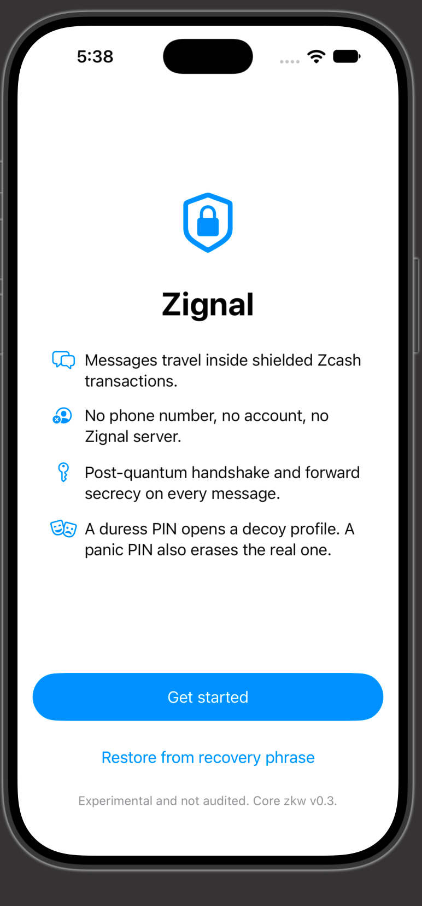
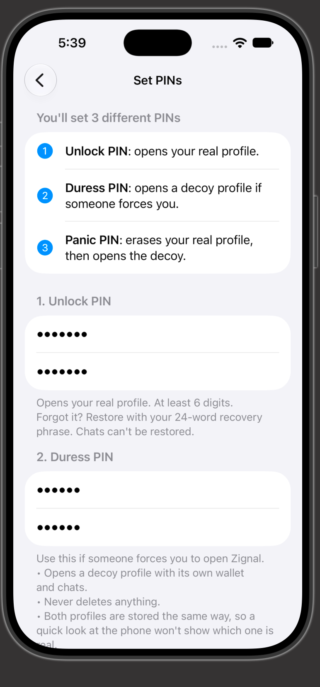
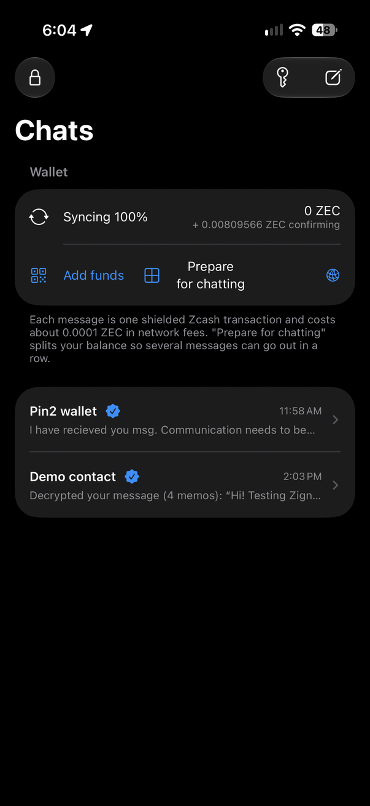
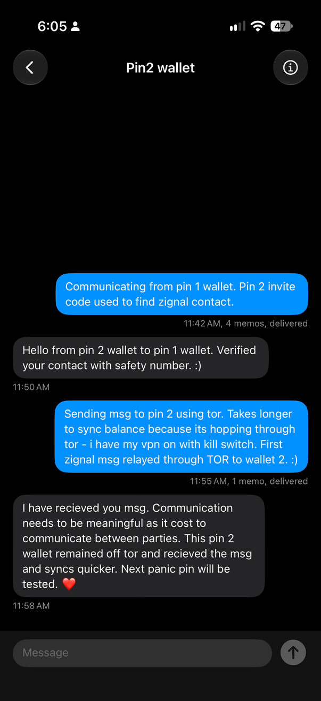
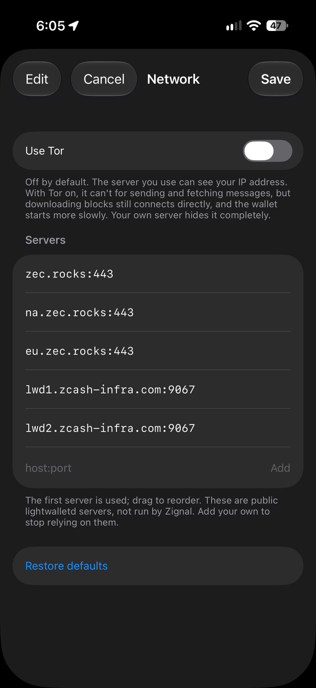
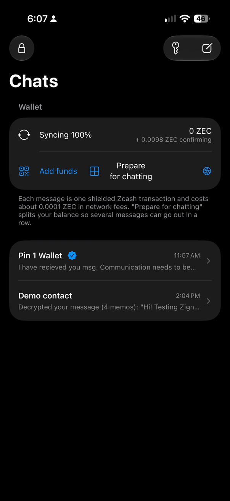
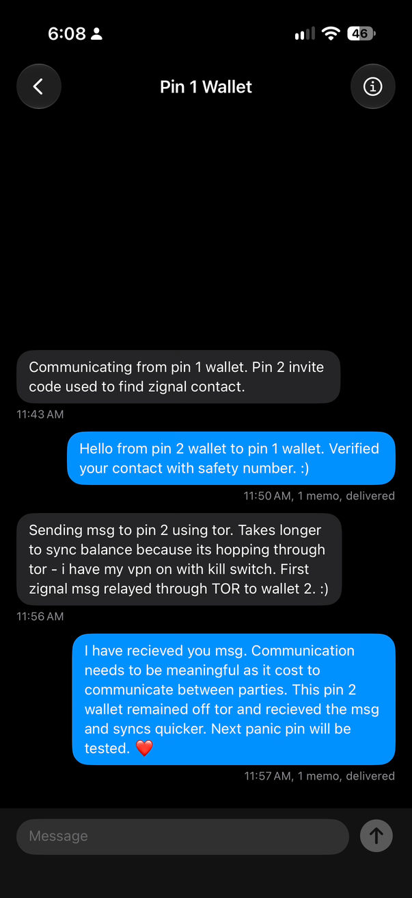
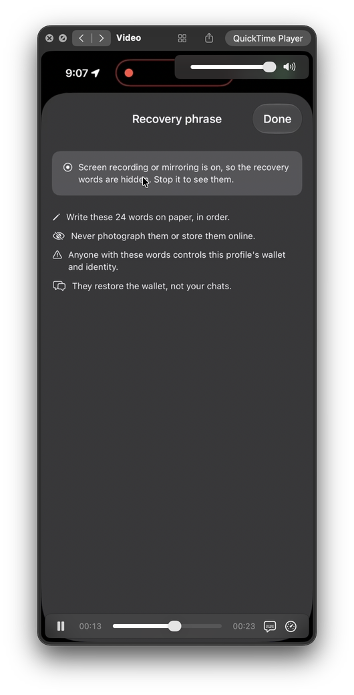
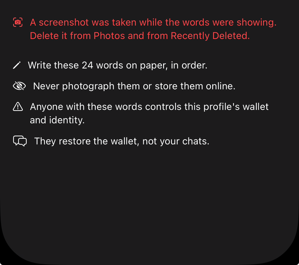

# Zignal

End-to-end encrypted messaging carried inside Zcash shielded transactions.

Two iPhones exchange a single-use QR invite. From then on, every message is one shielded
transaction on Zcash mainnet. There is no Zignal server, no account and no phone number.

On top of Zcash's own memo encryption, Zignal adds a post-quantum hybrid handshake and a
Double Ratchet. A leaked wallet viewing key reveals neither past messages nor who sent them.

> **Status:** experimental, built for the Zecathon (October 2026). Not audited.
> It runs on Zcash mainnet with real ZEC, so use small amounts.
>
> **You are reading the `dev` branch.** It is ahead of the Zecathon submission (`main`, tag
> `zecathon-final`): it supports NU7 and has the fixes listed in
> [This branch](#this-branch-dev) below.

## This branch (`dev`)

| Branch | What it holds |
|---|---|
| `main` | The Zecathon submission, tag `zecathon-final` (October 28, 2026). It stays as submitted until judging ends. |
| `nu7` | `zecathon-final` plus only the SDK update for NU7 (nothing in the app changes) and its README. Tagged `zecathon-nu7` after testing on mainnet past NU7 activation. |
| `dev` | Where work continues: the same SDK as `nu7`, plus app fixes. Tested releases move to `main` later. |

What `dev` changes compared with `main`, newest first. [CHANGELOG.md](CHANGELOG.md) lists every
change on `dev` with its commits and gets an entry with each fix.

| Date | Change | Why | Commits |
|---|---|---|---|
| Nov 12 | **A panic unlock takes as long as any other, and the wallet no longer sends its transparent addresses.** The clean-up after a panic wipe runs once the decoy is on screen, the wiped profile's file is overwritten under its own name, and the wipe counts as finished only after two unlocks find nothing left. The wallet no longer asks the server about its transparent addresses. | An outside review found that the clean-up (up to 15 seconds) ran before the decoy appeared, so a panic unlock could be told from a duress unlock by its delay, and that finishing a wipe gave the leftover file a new name. The SDK sent all of the wallet's transparent addresses on every sync, without Tor: the same identifier of the wallet each time, even with Tor on. | |
| Nov 11 | **Smaller fixes from the November reviews.** Profile files are written in a random order. The recovery words appear only once the app knows the screen isn't being recorded. Changing the server or Tor and then locking can't start a stopped wallet again, and a panic wipe waits for such a change to finish. Message text and the wallet address are copied only with Copy, which stays on this phone. | Each write makes a new file, so a fixed order let file IDs show which profile was saved. A recording already running could catch the words in its first frame. A server switch restarted the wallet even after a lock, so it could write a wiped profile's files again. Selected text went to the general pasteboard: other Apple devices, no expiry. | `487ba86` |
| Nov 11 | **A panic wipe that was cut short is finished the next time the decoy opens**, with the duress or the panic PIN. Every unlock stores the PIN vault again, and the Zcash SDK's one setting per wallet moves from the app's preferences into the wallet's own folder. | If the app was closed or the phone switched off during a wipe, the real wallet's database stayed on the phone until the panic PIN was entered again. The vault changed only on a panic wipe, so its change date in the Keychain dated the wipe. The app's preferences go into device backups and kept one entry for every wallet the app had opened. | `0d6a1fc` |
| Nov 11 | **The PIN vault is sealed by the iPhone's Secure Enclave**, and so is the device key for the profile files. The wrong-PIN wait is measured on a clock that can't be set (`CLOCK_MONOTONIC_RAW`), not the date and time. | A copy of the Keychain taken off an unlocked phone held the vault as it was, so the PINs could be guessed offline: a 6-digit PIN within hours. Now the vault opens only on this phone, through the app. Moving the clock forward used to shorten the wait. | `adbf62f` |
| Nov 9 | **Limits on what strangers can store.** Zignal's core keeps at most 32 contact requests and 64 incomplete multi-memo messages; the oldest go first. | Anyone with one of your addresses can send contact requests or partial messages for the price of a fee. Before, they were kept without a limit, and requests are saved with the profile. | `3f28c77` |
| Nov 7 | **"Checking whether it went out…"** replaces the red "Not sent" for the few seconds after unlocking while the wallet checks a send that a lock cut short. | The message had usually gone out. "Not sent" was alarming and invited a needless tap. | `220eba7` |
| Nov 7 | **The recovery words are hidden while the screen is recorded, mirrored or shared**, on the recovery phrase screen and in the restore field. A screenshot taken while they show brings up a warning to delete it. | A screen recording, AirPlay or screen sharing in a call would otherwise capture all 24 words. iOS can't block screenshots, so the app warns instead. | `d9ff597` |
| Nov 7 | **"Tap to send again" sends the same transaction again** when the wallet still holds it, instead of building a new one. | The Zcash SDK keeps a failed send's transaction and resends it every few minutes on its own until it expires, so a new transaction could be paid for twice. | `96668c4` |
| Nov 7 | **Add funds says received ZEC can be spent in about 4 minutes.** | NU7 brought 25-second blocks, so the 10 confirmations take about 4 minutes instead of 12. | `8c6a7f8` |
| Nov 7 | **Sending and receiving are more robust.** A contact's second message is no longer lost when it arrives before their first. A send cut short by a lock shows "sent" while its transaction waits to be mined, instead of "Not sent". "Tap to send again" can't send a message twice when tapped twice. | A new contact's early messages could be dropped when the wallet listed them before the message that opened the chat. Tapping "send again" too early or twice paid a second fee. | `3a78a62` |
| Nov 4 | **Security updates in the SDK's Rust dependencies:** `zstd` 0.13.4, `zstd-safe` 7.4.0, `zstd-sys` 2.1.2, `tokio` 1.53.3 and `event-listener` 5.4.2, all patch releases. The SDK library now builds with no compiler warnings. | Fixes RustSec advisories RUSTSEC-2026-0391, -0398, -0403, -0410, -0386 and -0221. Two advisories remain, through the Tor client, with no compatible fix yet (see [Security notes](#security-notes-and-known-limitations)). | `a10e69c` |
| Nov 3 | **Interrupted sends are no longer shown as failed.** If you lock the app while a message is sending, it shows "Not sent" at first. Once the wallet sees that message's transaction in a block, the message turns "delivered" by itself. "Tap to send again" checks this first. | Locking mid-send used to leave a "Not sent" message that had in fact gone out. Sending it again cost a second fee. | `5c173ee` |
| Nov 1 | **NU7 support.** The SDK's Rust library (`libzcashlc`) is now built from source on librustzcash's NU7 releases (`zcash_protocol` 0.11, `zcash_client_backend` 0.25, `zcash_client_sqlite` 0.23, `orchard` 0.16). Before, it was ECC's prebuilt 3.0.0 binary. | The 3.0.0 binary has no NU7 mainnet height. After block 3,543,405 it would use the wrong consensus branch ID: syncing stops and its transactions are invalid. ECC's SDK gets no NU7 release, so Zignal maintains its own fork. | `829ecb0` `f66c1c3` |
| Nov 1 | **Smaller SDK:** EIP-681 payment links and the Orchard-to-Ironwood pool migration are left out of the library. Stubs keep the same C declarations, so the Swift code is unchanged. | Zignal uses neither feature. About 13,000 lines of upstream code are no longer compiled. | `829ecb0` |
| Nov 1 | **Updated TLS libraries** for connections made from Rust (Tor): `rustls` 0.23.46, `rustls-webpki` 0.103.16, `webpki-roots` 1.0.11, `h2` 0.4.20. | These versions stop trusting the eight compromised eMudhra intermediate CAs disclosed on October 20, 2026, and fix RustSec advisories in `rustls` and `h2`. | `829ecb0` |
| Nov 1 | **The build keeps the builder out of the library.** File paths from the build machine are removed, and the build stops if any remain. The library targets iOS 17.0, the app's minimum. | By default, Rust and C compilers embed source file paths in a library, including the builder's home folder, and from there they end up in the app. | `f66c1c3` |
| Oct 29 | **Prepare** (formerly "Prepare for chatting") splits your balance only when it helps. It estimates how many messages can go out back to back from the last split. It waits while recent messages' change confirms, instead of splitting again. The button shows Ready, Confirming or Prepare, with one line saying why. | Before, the app could suggest splitting again when it didn't need to, and the long label wrapped onto two lines. | `04cd9fd` `cde5a42` |

Tested on `dev` (November 1 to 7, iPhone, Zcash mainnet):
- existing wallets upgraded to the new wallet database and kept syncing;
- messages both ways with Tor on and off, before and after NU7 activated (November 6, UTC);
- Add funds and Prepare;
- interrupted sends: each showed "sent", then "delivered", without a second fee, including one
  sent in airplane mode that went out once the network came back;
- the recovery words hidden during a screen recording, and the warning after a screenshot.

97 app tests and 2 UI tests pass.

> **Upgrading from the Zecathon build:** installing `dev` upgrades each profile's wallet
> database. This can't be undone: an older build can't open it afterwards. Keep your 24-word
> phrases: they restore the wallets in any build.

## Screenshots

<p>
  
  
  
</p>

From the iOS simulator: the welcome screen; the three PINs (unlock, duress for the decoy
profile, panic to erase the real profile); and the panic PIN, which must be confirmed as
something that can't be undone.

<p>
  
  
  
</p>
<p>
  
  
  
</p>

On an iPhone 16 Pro, on Zcash mainnet. The real profile (unlock PIN, "Pin 1") and the decoy
profile (duress PIN, "Pin 2") on the same phone exchange messages as two contacts: each
message is a shielded transaction, shown as delivered once it's in a block. One message went
out with Tor on. Top row: the real profile's chats and wallet, its side of the conversation,
and the network settings (Tor switch and server list). Bottom row: the decoy profile's chats
and wallet, its side of the same conversation, and its wallet syncing.

<p>
  
  
</p>

On `dev`, on an iPhone. Left: a screen recording of the recovery phrase screen, played back on
a Mac: while the recording runs, a notice takes the place of the 24 words. Right: the warning
after a screenshot of the same screen (the words above it are cropped out of this picture).

## What works today

- **Real messages on mainnet:** each profile has its own Zcash wallet. Messages go out as
  shielded transactions and arrive on the other phone after about one block plus a sync.
- **Invites:** show a single-use QR code on one phone, scan or paste it on the other, and send
  a first message. Each contact gets a fresh shielded address.
- **Delivery status:** sending, sent, delivered (in a block), or not sent, with tap to resend.
  A send cut short by locking the app shows sent while its transaction waits, then delivered
  once it's in a block.
- **Wallet:** balance and sync status, Add funds (QR code of a shielded address), Prepare
  (splits the balance so several messages can go out in a row, only when that helps), and
  network settings (server list and a Tor switch).
- **NU7 ready:** the wallet library is built from source on the NU7 releases of librustzcash.
- **Messaging core (Rust):** memo envelope, hybrid post-quantum handshake, Double Ratchet,
  inbox, replay protection, encrypted save and restore, three-PIN vault. Checked byte for byte
  against an independent Python reference.
- **Phone security:** an unlock PIN, a duress PIN that opens a working decoy profile with its
  own wallet, and a panic PIN that silently erases the real profile and opens the decoy. A
  24-word recovery phrase per profile, encrypted storage, lock on background, contact
  verification by safety number.
- **Demo contact:** a contact that lives on the phone and needs no ZEC. It runs the same
  protocol (handshake, ratchet, 512-byte memos) but never touches the network.

## How Zignal differs from a Zcash wallet

Wallets such as ZODL, Zingo, Ywallet or Cake are built for payments; their memo is a note
attached to a payment. Zignal is built for messages, and ZEC only pays the network fees.

| | A memo in a Zcash wallet | A Zignal message |
|---|---|---|
| Who can read it | Anyone with the recipient's viewing key, past and future memos alike | A viewing key shows only ciphertext: a second end-to-end layer with forward secrecy |
| Who sent it | No proven sender: anyone can write any name in a memo | Every contact is authenticated in the handshake; safety numbers to compare |
| Quantum | Zcash's note encryption uses classical cryptography | Hybrid post-quantum handshake (X25519 + ML-KEM-768) inside the memos |
| Addresses | You hand out your wallet address | A fresh shielded address per contact; no transparent addresses |
| Conversation | Shown with each transaction | A chat per contact, delivery status, long messages split across memos |
| On the phone | PIN or Face ID | Duress PIN with a working decoy wallet; panic PIN that erases the real profile |
| Wallet features | Full: any address type, transparent funds, often swaps | Deliberately minimal and shielded-only: enough to fund your messages |

Zignal doesn't yet show plain-text memos that other wallets attach to the ZEC they send you;
that's on the roadmap.

## Try it

- **TestFlight:** pending Apple Developer approval. Until then, build from source with Xcode
  (see Build and test); a free Apple ID can install it on your own iPhone.
- **Two iPhones:** on each, set PINs and back up the recovery phrase, then fund the wallet
  with about 0.01 ZEC (Add funds). Received ZEC can be spent after 10 confirmations.
  Receiving messages needs no ZEC: the sender pays the network fee.
  Zignal only uses shielded addresses: to fund it from an exchange, withdraw to a wallet that
  accepts transparent deposits (such as ZODL), shield there, then send to Zignal.
  On one phone: New chat > Show my invite. On the other: New chat > Scan or paste an invite,
  then write a first message.
- **One iPhone, on chain:** set up and fund both profiles, then in one profile New chat >
  Show my invite > Copy invite, and in the other New chat > Scan or paste an invite > Paste.
- **One iPhone, no ZEC:** use the demo contact (New chat > Start demo chat) to see the full
  protocol without touching the network.
- **Tested on:** iPhone 16 Pro, iOS 27, Zcash mainnet: invites by paste, messages both ways
  with delivery status, safety numbers, Tor on and off. `dev` was tested again November 1 to 7
  (see [This branch](#this-branch-dev)).

## Repository layout

| Path | What it is |
|---|---|
| `zkw-core/` | Rust messaging core: memo envelope, handshake, Double Ratchet, inbox, persistence, PIN vault |
| `zkw-ref/` | Python reference implementation and test vectors (the protocol's ground truth) |
| `zkw-ffi/` | Swift bindings for `zkw-core` (UniFFI) and the iOS XCFramework build script |
| `ios/Zignal/` | SwiftUI iOS app: `Core/` (storage, vault, sessions, wallet), `UI/` (screens), `Generated/` (bindings) |
| `ios/Zignal/scripts/` | Downloads and hash-checks the Zcash Sapling parameters bundled into the app |
| `vendor/zcash-swift-wallet-sdk/` | Zignal's fork of the Zcash Swift SDK 3.0.0 (MIT): two fixes in the Swift code (and on `dev` three more changes), and its Rust layer on the NU7 crates, built with `Scripts/build-ios-ffi.sh`. See `ZIGNAL-PATCHES.md` there |

## Protocol at a glance

- **Transport:** one shielded Zcash transaction per message. Each 512-byte memo is a
  zero-value output to the contact's address, so the recipient never receives dust. Long
  messages use up to 15 memos in the same transaction (ZIP-321 multi-output).
- **Envelope:**
  - Fixed 512 bytes: a 25-byte header, up to 402 bytes of text per memo, and random padding.
  - The first byte is `0xFF`, which marks the memo as binary data under ZIP-302, so wallets
    never try to read it as text.
  - Receipts and reactions are indistinguishable from text on the wire.
- **Handshake:** PQXDH-style hybrid of X25519 and ML-KEM-768 (FIPS 203), with signed prekeys.
  The initiator's identity is encrypted inside the handshake.
- **Messages:** Double Ratchet with header encryption (forward secrecy and post-compromise
  security).
- **Contacts:** single-use invites by QR code or paste. Each contact gets its own receive
  address. Contacts verify each other with a 60-digit safety number. The core also supports
  cold contact requests that the recipient must accept; the app doesn't offer them yet.
- **Conversation lookup:** a tag that rotates daily instead of any sender identifier.
- **Primitives:** X25519, Ed25519, ML-KEM-768, ChaCha20-Poly1305, HKDF-SHA256, Argon2id,
  all from audited RustCrypto and dalek crates. No custom primitives.

## How the app uses Zcash

- **One wallet per profile.** The real and decoy profiles each have their own wallet, derived
  from that profile's 24-word phrase (BIP-39). The phrase restores the wallet and identity,
  not chat history.
- **Shielded only.** Addresses have a single Orchard receiver, and a new one is made for every
  contact and every invite, so contacts can't link you across chats. No transparent address
  is ever shown or used. Since NU6.3, these payments land in the Ironwood shielded pool.
- **Fees:** standard ZIP-317 fees, 0.0001 ZEC for a one-memo message. Fees are public and
  reveal roughly how many memos a transaction carried.
- **Receiving:** after each sync, new transactions are read in chain order, each at its own
  block time, so a message read days later still finds its chat.
- **Delivered** means the transaction is in a block. There are no read receipts, which would
  cost the reader a transaction and reveal when they read.
- **Servers:** public lightwalletd servers by default (zec.rocks and zcash-infra), editable in
  the app, including your own. Tor is off by default and can be switched on per profile.
- **Sapling parameters** are bundled in the app and checked against pinned hashes at build
  time, so the app never downloads them.
- **NU7:** the SDK's Rust library is built from source on librustzcash's NU7 releases, so the
  wallet follows the network upgrade at block 3,543,405. From NU7 it builds version 6
  transactions with a 120-block expiry, and addresses stay revision-0 `u1…` addresses. EIP-681
  parsing and the pool migration, which Zignal doesn't use, are left out.
- **Patched SDK:** the app builds against Zignal's fork of the Zcash Swift SDK 3.0.0 in
  `vendor/`. Its Swift code fixes two bugs in the released SDK
  that kept a locked wallet working in the background until the app was closed: stopping a
  wallet while it was syncing could be undone by the SDK's own retry timer, and every sync
  started another mempool watcher that stopping didn't end (each kept a server connection
  open and could recreate a deleted wallet database). With the fixes, a stopped wallet stays
  stopped. Details in `vendor/zcash-swift-wallet-sdk/ZIGNAL-PATCHES.md`; both are reported
  upstream in [zcash/zcash-swift-wallet-sdk#2012](https://github.com/zcash/zcash-swift-wallet-sdk/issues/2012).
  On `dev`, three more changes: the SDK's per-wallet record of its witness repair is kept in
  the wallet's own folder instead of the app's preferences, a server switch no longer
  restarts a wallet the app has stopped, and the wallet never asks the server about its
  transparent addresses.

## How the app protects data on the phone

**PINs**
- Your unlock, duress and panic PINs each open one slot in a fixed-size, three-slot vault
  (Argon2id, 64 MiB). Each attempt runs Argon2id once and then tries every slot, so all three
  PINs take the same time and nothing on disk says which slot is which.
- The vault is stored in the Keychain (this device only, never synced), encrypted to a P-256
  key in the iPhone's Secure Enclave: ECDH with a fresh ephemeral key, HKDF-SHA256, then
  AES-GCM. The Secure Enclave key never leaves the chip and works only on this phone, while
  it's unlocked, for this app. So a copy of the Keychain taken off the phone can't be opened,
  and the PINs can't be guessed offline from it.
- An install from before this change seals its vault the first time it opens and its device
  key at the first unlock, without asking for a PIN. Each old copy is deleted only after the
  sealed one has been read back and opened.
- 5 wrong PINs are free; after that, each try waits 30 seconds, doubling up to 1 hour, shown
  as a live countdown. Each try is counted in the Keychain before the PIN is checked, so
  force-quitting the app doesn't reset the count. The wait is measured on
  `CLOCK_MONOTONIC_RAW`, which keeps counting while the phone sleeps and can't be set, so
  changing the date or time doesn't shorten it. A restart can start the wait over but never
  shortens it.

**Duress and panic**
- The duress PIN opens a decoy profile that looks and works like a normal one, with its own
  wallet. It never starts a wipe; it only finishes one that the panic PIN started.
- The panic PIN is a last resort. It silently destroys the real profile (its PIN slot, its
  saved data, its wallet files and the Zcash SDK's settings for that wallet), then opens the
  decoy as usual. The clean-up runs once the decoy is on screen, so a panic unlock takes as
  long as any other; it waits for any wallet that is still stopping, so nothing can write
  the real profile's files again after they are deleted. The phone keeps the same profile
  file names at the same size: the real profile's file is overwritten with filler under
  its own name, as every save rewrites every file. The wiped profile's wallet files are
  deleted without a replacement, which leaves a trace (see
  [Security notes](#security-notes-and-known-limitations)).
- Until the wipe is confirmed finished, the decoy profile's own sealed data records that it
  is under way. If the app is closed or the phone switched off before then, the next time
  the decoy opens, with the duress or the panic PIN, the wipe is finished. It counts as
  finished only after two unlocks in a row find nothing of the wiped profile left.
- Every successful unlock stores the vault again under a new seal, so its Keychain item
  changes on every unlock, not only when the panic PIN is used.
- Changing the server or Tor can take a few seconds. If the profile locks meanwhile, the
  wallet is stopped again when the change finishes (a server switch used to restart it),
  and a panic wipe waits for the change like it waits for a wallet that is stopping.
- The app never shows which profile is open.

**Storage**
- Each profile's data is sealed under that profile's own key, inside a second layer sealed
  under a random 32-byte device key. The device key is stored in the Keychain sealed by the
  Secure Enclave, the same way as the vault.
- The Zcash SDK keeps one setting per wallet (the app version for which it last repaired
  that wallet's notes). It is a file in the wallet's own folder, which isn't backed up and
  is deleted with the wallet, and no longer an entry in the app's preferences, which go
  into device backups. The app deletes the old entries each time it starts.
- Every save rewrites all profile files to one common size with the same timestamps, so the
  files change together whichever profile is in use. They're written in a random order:
  each write makes a new file, so a fixed order could show which profile was saved.
- Data is saved before anything is sent, so a crash can't cause message keys to be reused.
- Profile files and wallet files use complete data protection and are excluded from device
  backups. Wallet file names are derived from each profile's key and don't say which profile
  is which.

**Screen and input**
- The app locks when it goes to the background. Locking stops the profile's wallet: no more
  syncing, network traffic or file writes for that profile until it is unlocked again.
- A cover window hides it, including open sheets and alerts, in the app switcher.
- Third-party keyboards are blocked, and the message box has autocorrect off.
- Received text is shown verbatim, never rendered as Markdown or links.
- Copied invites, addresses and message text stay on this phone (no Universal Clipboard)
  and clear after five minutes. Message text and the wallet address can't be selected;
  copy them with Copy (touch and hold a message).
- The recovery words appear only once the app knows the screen isn't being recorded,
  mirrored or shared, so a recording that's already running doesn't catch them.

**Logging and network**
- The app has no logging and no analytics, and the Zcash SDK's logging is turned off.
- Its only network traffic is the wallet talking to the server you choose.

## Network privacy: Tor, a VPN or your own server

Zcash hides sender, recipient and amount on chain. Who connects to the server, from which IP
address and when, is a separate problem, and the app can only solve part of it.

**What the server sees**
- **Tor off (the default):** the server you use sees your IP address with every request:
  the transactions you send, the ones it fetches for you to read messages, and the blocks you
  download. One server operator often sees the sender's IP address submit a transaction and
  the recipient's IP address fetch it, which shows who writes to whom and when, even though
  the messages stay encrypted.
- **Tor on (in the network settings):** sending, fetching transactions, checking the server
  and reading the chain tip go over Tor, so the server sees a Tor exit instead of your IP
  address. Syncing still connects directly: downloading blocks, tree states and subtree
  roots, which are the same for every wallet. The server learns that you use Zcash and when
  you sync, not which transactions are yours. Tor depends on no single company, but it's
  slower.
- **No wallet identifier:** until November 12, the wallet also sent all of its transparent
  addresses on every sync, directly even with Tor on, which let the server recognize the
  same wallet across IP addresses, VPN exits and Tor. Zignal uses shielded addresses only
  and no longer asks about transparent ones.
- **Your own server:** point Zignal at a lightwalletd you run, and no third party sees your
  requests.

**Compared with Zodl's relay (November 2026).** Zodl 3.20 sends its wallet requests through
Oblivious HTTP: a relay run by Cloudflare or Fastly sees your IP address but not the request,
and ZODL's gateway sees the request but not your IP address. Linking the two takes both
companies working together. With Tor on, Zignal gets the same protection for sending and
fetching, the requests that show which transactions are yours, in a different way.
Syncing (block downloads) isn't covered yet. Zignal doesn't use ZODL's relay code: it is licensed
AGPL-3.0-only, with no permission for App Store distribution. Asking ZODL whether Zignal may
use it is on the [roadmap](#roadmap-after-the-zecathon).

**Using a VPN (recommended, with a kill switch and a no-logs provider).** Privacy-focused
Zcash users should consider a VPN as well as Tor. Here is what changes.

| Who | Without a VPN | With a VPN and a kill switch |
|---|---|---|
| Your internet provider or the Wi-Fi owner | Sees that you connect to a Zcash server, and when | Sees only an encrypted connection to the VPN |
| The light server | Your IP address with every send, fetch and block download | The VPN's address for everything, block downloads included |
| The VPN company | Not involved | Your IP address, which server you use, when and how much. Not the content: the connection to the server is encrypted |
| The blockchain, a viewing-key holder, someone holding your phone | No change | No change |

- **Turn on the VPN's kill switch.** Zignal's wallet reconnects by itself. If the VPN drops
  without a kill switch, the next sync or send leaves from your real IP address, and one such
  request is enough to link the VPN's address to you. On iPhone, choose a VPN whose kill
  switch sends all traffic through the VPN (often called "include all networks" or "block
  connections without VPN"), and check it's still on after every VPN app update.
- **Choose a no-logs provider, and check the claim.** A VPN sees your real IP address next to
  every server you talk to, so its records matter more than anyone else's. Look for:
  - a no-logs policy that an independent firm has audited recently, with the report
    published;
  - a record of what the company handed over when it received legal requests (a transparency
    report, or a court case where nothing was there to hand over);
  - payment without your name: cash or cryptocurrency, an account number instead of an email
    address;
  - servers that keep nothing on disk (RAM-only), and a jurisdiction you're comfortable with.

  "No logs" in an advert proves nothing; an audit and a track record are evidence, not proof.
- **Use a shared address, not a dedicated one.** Many users behind the same VPN address hide
  each other. A dedicated or static address becomes a fixed identity the server can follow.
- **What a VPN doesn't do.** Every request from your phone comes from the same VPN address,
  so the server can still group your own requests together ("this user sent A, fetched B,
  synced at 9 PM") without knowing who you are. A VPN company that keeps logs, or is ordered
  to, and a server operator who cooperates could link you. A VPN changes nothing on the
  blockchain, nothing a viewing-key holder sees, and nothing for someone holding your
  unlocked phone.
- **The strongest setup today: a VPN with a kill switch, plus Tor on in Zignal.** Your
  internet provider sees only the VPN. The VPN sees only Tor traffic for sends and fetches.
  The server sees Tor for sends and fetches and the VPN's address for syncing. No
  single party sees your IP address together with your transactions. The cost is speed:
  syncing and sending are slower.
- **Your own server at home:** a kill switch that blocks local network access also blocks a
  server on your home network. Either allow local network access in the VPN app, or reach
  your server through the VPN.

## Build and test

Requirements: macOS with Xcode 27, an iPhone on iOS 17 or later, Rust (`rustup`), and
Python 3.11+ with `cryptography` (reference only).

```bash
# First time only: download the Rust dependencies. The build script then works offline.
(cd zkw-core && cargo fetch) && (cd zkw-ffi && cargo fetch)

# Rust core tests, including byte-for-byte checks against the Python reference
cd zkw-core && cargo test

# Python reference tests
cd zkw-ref && python3 -m unittest -v

# Swift bindings + iOS XCFramework, plus the binding tests
cd zkw-ffi && ./build-ios.sh

# Zcash Sapling parameters (about 51 MB from download.z.cash, size and hash checked)
bash ios/Zignal/scripts/fetch-sapling-params.sh

# The Zcash SDK's Rust library (libzcashlc) for iPhone and the Simulator, on dev and nu7.
# Needs Rust 1.97 or newer. The first build downloads the crates and takes a few minutes.
rustup target add aarch64-apple-ios aarch64-apple-ios-sim   # Intel Mac: x86_64-apple-ios
vendor/zcash-swift-wallet-sdk/Scripts/build-ios-ffi.sh
```

`build-ios-ffi.sh` installs the library in `vendor/zcash-swift-wallet-sdk/LocalPackages/`
(git-ignored), which the SDK's `Package.swift` links. There is no fallback to ECC's prebuilt
binary, which stops working at NU7: without this step, Xcode reports the missing library.
Run it again after pulling changes to `vendor/`.

Then open `ios/Zignal/Zignal.xcodeproj`:
- Cmd+U runs the 97 app tests and the 2 UI tests. They cover:
  - PIN rules and the wrong-PIN wait, the three-PIN vault (duress and panic), and a timing
    test for each unlock step;
  - the Secure Enclave seal (round trip, tampering, the wrong key or label), moving an older
    install's Keychain items under it, a move cut short, and a sealed vault winning over an
    older plain copy after a panic wipe, and a new seal each time the vault is stored;
  - the wrong-PIN wait after a restart and with state saved by older versions;
  - storage encryption and tamper checks, the random write order, what a silent wipe leaves
    behind (the same file names), a wipe cut short being finished later with the usual two
    profile files, and a wipe counted finished only after two clean unlocks;
  - recovery phrases, and the demo chat across restarts;
  - payment request encoding and address checks, invite parsing against a real invite from
    the core, and copying an invite as text;
  - memo filtering, wallet settings and messages, waiting for stopped wallets and for
    settings changes, and removing the SDK's old entries from the app's preferences;
  - when Prepare splits or waits; interrupted sends found in the wallet, sent again as the same
    transaction and shown as "Checking" until the wallet has looked; and reading a chat's first
    message before the rest.
- The Zcash SDK is a local package in `vendor/`. On the first build Xcode downloads its Swift
  dependencies (grpc-swift, SQLite.swift).
- Cmd+R runs the app. The wallet connects to the first server in its list.

## Security notes and known limitations

To report a vulnerability privately, see [SECURITY.md](SECURITY.md).

- **Not audited.** Treat as experimental software. Friends of the project reviewed `dev` in
  November 2026; what they found is fixed or listed below.
- **On chain:** Zcash shielded transactions hide sender, recipient and amount. Your IP address
  and timing are a separate problem.
- **Network privacy:** with Tor off (the default), the server you use sees your IP address
  and which transactions are yours: the ones you send and the ones it fetches for you to read.
  That links who messaged when to an IP, even though the contents stay encrypted. The Zcash
  SDK's Tor covers sending and fetching; syncing (blocks, tree states) still connects
  directly, and the wallet sends no transparent addresses at all. Your own
  server removes the third party entirely. A VPN with a kill switch and a no-logs provider,
  together with Tor, covers the rest (see
  [Network privacy](#network-privacy-tor-a-vpn-or-your-own-server)).
- **Transparent addresses:** Zignal never gives out a transparent address and doesn't look
  them up. ZEC sent to one of the wallet's transparent addresses isn't shown; restoring the
  24 words in a full Zcash wallet recovers it.
- **Tor and certificates:** with Tor on, the server's certificate is checked by the Zcash SDK's
  own code, not by iOS. The Zecathon build (`main`, SDK 3.0.0) still trusts eight certificate
  authorities whose keys leaked in October 2026. iOS itself already blocks them, so Tor off
  is not affected. Someone holding one of those keys and sitting between Tor and the server
  could pose as the server: see which transactions you fetch, hide or fake server data, block
  sends. They can't take funds or read messages. **Fixed on `dev` and `nu7`**, which use
  `rustls-webpki` 0.103.16 and `webpki-roots` 1.0.11.
- **A send that didn't finish:** after a lock or a crash, the message shows "Checking whether
  it went out…" until the wallet has looked, then "sent" while its transaction waits to be
  mined. If it never reached the server, the Zcash SDK resends it every few minutes while the
  app is open, until it's mined or expires (about 50 minutes). When a send fails outright,
  "Tap to send again" sends the same transaction if the wallet still holds it, so a message
  is paid for once.
- **Message length shows in the fee:** each memo adds an output, so the fee (and the number of
  actions in the transaction) shows roughly how long a message was. Padding to fixed sizes
  would hide it at a higher fee; that's on the roadmap.
- **Remaining RustSec advisories** in the SDK's dependencies, both through arti (the Tor
  client, off by default), with no compatible fix yet:
  - `rsa`: the Marvin attack targets private-key decryption; a Tor client only verifies
    signatures;
  - `crypto-bigint`: used for SSH key parsing for onion services, which Zignal doesn't use.

  Details in `vendor/zcash-swift-wallet-sdk/ZIGNAL-PATCHES.md`.
- **Tor library version:** the Tor client (arti 0.43) dates from around June 2026. Arti 2.8.0
  (November 3, 2026) fixes several low-severity security issues, but librustzcash's NU7
  releases pin arti 0.43, so an update needs a new librustzcash release. Requested upstream in
  [zcash/librustzcash#3246](https://github.com/zcash/librustzcash/issues/3246). Tor is off by
  default.
- **Open app only:** messages arrive while the app is unlocked and synced. There are no push
  notifications, which would need a Zignal server.
- **Cost and delay:** each message costs a normal network fee and arrives after about one block
  plus a sync.
- **Wallet files:** the Zcash SDK stores each wallet in a plaintext database, protected by iOS
  file protection. A forensic image of an unlocked phone could tell which wallet has history.
- **Seed in memory:** while a profile is unlocked, its wallet seed stays in memory to sign
  sends. Swift can't reliably wipe memory after lock; the Rust core wipes its own copies.
- **PIN strength:** with a copy of the Keychain, PINs can only be tried on the phone itself,
  through the app: about a second per try, plus the wrong-PIN wait. Someone who can run their
  own code inside Zignal on an unlocked phone (through an iOS exploit) could open the seal
  and then guess offline as before: a 6-digit PIN within hours. Use 8 or more digits for real
  use. Each extra digit multiplies the work by 10, and Zignal accepts up to 16.
- **Decoy realism:** a decoy profile is only convincing if it's used now and then and holds
  a little ZEC.
- **Panic PIN:**
  - It can't be undone. The real wallet's funds come back only with its 24-word phrase, so
    keep that phrase off the phone; chat history can't be recovered.
  - Someone who saw your unlock PIN work before will notice that it stops working.
  - It erases only what's on this phone. Transactions stay on chain (unreadable without the
    keys), the server may keep its own records of your IP address, your contacts keep their
    copies, and the app itself stays installed.
  - Wiping data while being forced to unlock may carry legal risk where you live.
  - A wipe is detectable by someone who knows how Zignal works: two wallets' files normally
    exist, and afterwards only one does.
  - If the app is closed or the phone switched off during a wipe, the real wallet's database
    stays on the phone (its seed is already gone) until the decoy opens again, with the
    duress or the panic PIN, which finishes the wipe. Only if the app stops in the instant
    between wiping the vault slot and recording that a wipe is under way does it stay until
    the panic PIN is entered again.
  - Opening the decoy never waits for the clean-up: a wallet that is still stopping is
    waited for in the background, after the decoy is on screen.
- **The panic PIN leaves a trace:** it destroys the real profile and keeps the same number of
  profile files, but the real profile's wallet files are deleted without a replacement.
  Someone examining the phone's files can then see that only the open profile has a wallet.
  Many phones look like that anyway (a profile's wallet only appears once it's opened), but
  next to a decoy wallet created minutes earlier it can suggest a wipe. A fix is planned.
- **PINs against a forensic copy:** the vault and the device key are sealed by a key in this
  iPhone's Secure Enclave, so a copy of the Keychain taken off the phone can't be opened
  anywhere else, and the PINs can't be guessed offline from it. Tools that can run code as
  Zignal on the unlocked phone could still open the seal (see PIN strength). Debug builds on
  a device without a Secure Enclave (some Simulators) keep the sealing key in the Keychain
  instead; release builds refuse to set up there.
- **Wrong-PIN wait after a restart:** restarting the phone during a wait can start the wait
  over. It never ends it early.
- **Recovery words on screen:** they're hidden while the screen is recorded, mirrored or
  shared. iOS can't block screenshots or stop a camera pointed at the screen: after a
  screenshot the app warns you to delete it, and nothing can detect a camera.
- **One phrase, two roles:** a profile's 24-word phrase is both its wallet seed and its
  messaging identity. Anyone with the words can spend the funds and pose as you to your
  contacts with the same safety number, though they can't read past messages.
- **First message of a chat:** forward secrecy for the very first message rests on the weekly
  rotation of signed prekeys; there are no one-time prekeys yet. From the first reply on, the
  Double Ratchet applies.
- **Unused invites** stay valid for about three weeks, and whoever uses one first becomes that
  contact. Compare safety numbers before trusting a chat.
- **Spam:** anyone with one of your addresses can send you contact requests (not shown in the
  app yet) or partial messages for the price of a fee. Zignal's core keeps at most 32 requests
  and 64 incomplete messages, dropping the oldest first.
- **NU7:** NU7 activated on mainnet at block 3,543,405 on November 6, 2026, at 02:34 UTC.
  - The Zecathon build (`main`, `zecathon-final`) uses SDK 3.0.0's prebuilt library, so it
    stops syncing and can't send after that.
  - ECC's SDK ends support at NU7. Its final release, 4.0.0, doesn't include NU7, and
    development continues in the ZODL Swift Wallet SDK (AGPLv3).
  - Zignal chose to keep its own MIT fork in `vendor/`: SDK 3.0.0's Swift code with Zignal's
    two fixes, and its Rust layer rebuilt on librustzcash's NU7 releases.
  - That update is on `nu7`, changing only the SDK in `vendor/` (and the README), and on
    `dev`. It is tagged `zecathon-nu7` and was tested on mainnet after activation.
  - The light server you use must run NU7-ready software (Zebra 7.0.0 or later), or syncing
    stops until it does.

## Roadmap (after the Zecathon)

- **TestFlight**, once the Apple Developer account is approved.
- **NU7 compatibility:** done on `nu7` and `dev`, tagged `zecathon-nu7` after testing past
  activation (see [This branch](#this-branch-dev)).
- **Length privacy:** an option to pad messages to fixed memo counts, so the fee doesn't show
  how long a message was.
- **Prebuilt SDK library:** publish the built library with each release, so building the app
  doesn't need Rust.
- **Notes from other wallets:** show the text memos that other wallets attach to the ZEC they
  send you, read-only and labelled "sender not verified", with no links.
- **Send to other shielded wallets**, with a plain memo.
- **Import a wallet** into either profile from its 24-word phrase, with a clear warning that
  an existing wallet's history becomes linked to your messaging addresses.
- **Contact requests:** start a chat with any Zignal user from their shielded address, with a
  requests inbox, accept and block, and a small fee for strangers. QR invites stay for meeting
  in person and verifying each other.
- **Hardening from our review:** one-time prekeys for the first message, show when a contact
  resets a chat, and let users revoke unused invites. Hiding the recovery words during screen
  capture and limiting stored contact requests are done on `dev`.
- **From the November reviews:** a panic wipe that leaves the wallet folder looking the same.
  The PIN vault sealed by the Secure Enclave, a wrong-PIN wait that doesn't follow the
  clock, finishing a panic wipe that was cut short, and the fixes of November 11 and 12
  are done on `dev`.
- **Faster first sync:** recent checkpoints, so a new wallet starts near the chain tip instead
  of scanning from mid-2026.
- **Ask ZODL** whether Zignal may use its Oblivious HTTP relay (client, relays and
  gateway), or on what terms (see [Network privacy](#network-privacy-tor-a-vpn-or-your-own-server)).
- **Tor library update**, once librustzcash moves to a current arti
  ([zcash/librustzcash#3246](https://github.com/zcash/librustzcash/issues/3246)).
- **Later:** post-quantum protection for every message (not only the handshake), and Android.

## Development log

Zignal's own code up to `zecathon-final` was written during the Zecathon build window. Dates
match the git history; the rows after October 28 are on `dev`.

| Date | Commit | Milestone |
|---|---|---|
| 2026-10-06 | `7339654` | Protocol v0.2: Python reference and Rust core with byte-exact test vectors |
| 2026-10-07 | `2ca7515` `3dfc72f` `c208e0b` | Swift bindings (UniFFI), iOS app on the Zcash Swift SDK, encrypted inbox save/restore, Rust core linked into the app |
| 2026-10-08 | `f6273cd` | iOS app: PIN setup, duress unlock, encrypted two-layer profile storage, demo chat |
| 2026-10-10 | `b4c324d` | Protocol v0.3: memos start with `0xFF` (ZIP-302 binary data) |
| 2026-10-18 | `9377c38` | 24-word recovery phrase (BIP-39) backup and restore for each profile |
| 2026-10-19 | `6cbd976` | PIN entry: profiles open off the main thread, live wrong-PIN countdown |
| 2026-10-19 | `df8bd04` | Real messages on mainnet: wallet per profile, invites, sending and receiving, delivery status, network settings |
| 2026-10-24 | `5e24121` | Silent wipe also removes the wiped profile's saved data and wallet files |
| 2026-10-25 | `1ccba0e` | Panic PIN: three-slot vault (v2); duress never erases, panic erases the real profile |
| 2026-10-25 | `7286d05` | Clearer wording on the Set PINs screen |
| 2026-10-26 | `6793b8c` `7b350bf` | Wallets really stop on lock: Zcash SDK 3.0.0 vendored in `vendor/` with two stop bugs fixed; the panic PIN waits for stopped wallets and also removes the SDK's settings for the wiped wallet |
| 2026-10-26 | `2b0b86d` `eb7b148` | README for the patched SDK and the three-PIN vault; MIT OR Apache-2.0 license files |
| 2026-10-27 | `5ec04bb` | Pasting invites works (copied as UTF-8 text), Paste comes first on the add-contact screen, clearer wallet messages |
| 2026-10-28 | `462335c` | Zecathon submission (`zecathon-final`) |
| 2026-10-29 | `04cd9fd` `cde5a42` | `dev`: Prepare splits only when it helps; the button is named Prepare |
| 2026-11-01 | `829ecb0` `f66c1c3` | `nu7` and `dev`: the SDK's Rust layer on the NU7 crates, built from source for iOS 17.0 and later |
| 2026-11-03 | `5c173ee` | `dev`: interrupted sends turn delivered once they're on chain |
| 2026-11-04 | `a10e69c` | `nu7` and `dev`: security updates (zstd, tokio, event-listener), no build warnings |
| 2026-11-07 | `3a78a62` | `dev`: a new contact's second message is read even when it arrives first; interrupted sends show sent while they wait; no double send |
| 2026-11-07 | `8c6a7f8` | `dev`: Add funds says about 4 minutes after NU7 |
| 2026-11-07 | `96668c4` | `dev`: send again resends the same transaction |
| 2026-11-07 | `fe61388` | `dev`: README says what `dev` changes compared with the submission |
| 2026-11-07 | `d9ff597` | `dev`: recovery words hidden during screen recording and mirroring; screenshot warning |
| 2026-11-07 | `220eba7` | `dev`: "Checking" instead of "Not sent" after a lock |
| 2026-11-09 | `3f28c77` | `dev`: limits on stored contact requests and incomplete messages |
| 2026-11-09 | `c6a9e82` | `dev`: README lists the new changes, the November tests and two screenshots |
| 2026-11-09 | `9df2f92` | `dev`: CHANGELOG.md and SECURITY.md (private vulnerability reporting) |
| 2026-11-09 | `31280e6` | `dev`: README lists what the November reviews found and what's planned |
| 2026-11-11 | `adbf62f` | `dev`: PIN vault and device key sealed by the Secure Enclave; wrong-PIN wait on the boot clock |
| 2026-11-11 | `0d6a1fc` | `dev`: interrupted panic wipes finished; vault resealed on every unlock; SDK setting out of backups |
| 2026-11-11 | `487ba86` | `dev`: random file write order; words hidden until capture is known; no wallet restart after lock; local copy; network privacy section |

## Credits

Zignal's own code is everything in this repository except `vendor/`. It builds on these
libraries:

- **Zcash Swift SDK** ([ZcashLightClientKit](https://github.com/zcash/zcash-swift-wallet-sdk),
  MIT, Znewco, Inc. (Zcash Open Development Lab), maintained in the `zcash` GitHub
  organization): wallet sync, keys, addresses and transactions. Release 3.0.0 is
  included in `vendor/` under its own MIT license, with Zignal's two fixes (and on `dev` three
  more changes) and, on `dev` and `nu7`, its Rust layer rebuilt on the NU7 crates, all
  listed in `ZIGNAL-PATCHES.md`. It includes
  **[librustzcash](https://github.com/zcash/librustzcash)** (MIT/Apache-2.0) and
  **[arti](https://gitlab.torproject.org/tpo/core/arti)** (Tor in Rust, MIT/Apache-2.0).
- **RustCrypto** crates: `ml-kem`, `chacha20poly1305`, `hkdf`, `hmac`, `sha2`, `argon2`.
- **dalek-cryptography**: `x25519-dalek`, `ed25519-dalek`.
- **`bip39`** crate for recovery phrases.
- **[UniFFI](https://github.com/mozilla/uniffi-rs)** (Mozilla, MPL-2.0) for the Swift
  bindings.
- **Python `cryptography`** for the reference implementation.
- **Apple frameworks:** SwiftUI, VisionKit (QR scanning), Core Image (QR codes).
- **Protocol design:** the handshake and ratchet follow the PQXDH and Double Ratchet
  specifications published by Signal. No code was taken from Signal.
- **Public lightwalletd servers** run by zec.rocks and zcash-infra, used as defaults.
- **AI assistance:** built with help from Claude (Anthropic); commits list it as co-author.

## License

Zignal's own code is dual-licensed under either of:
- MIT license ([LICENSE-MIT](LICENSE-MIT))
- Apache License, Version 2.0 ([LICENSE-APACHE](LICENSE-APACHE))

at your option. `vendor/zcash-swift-wallet-sdk/` keeps its own MIT license.
