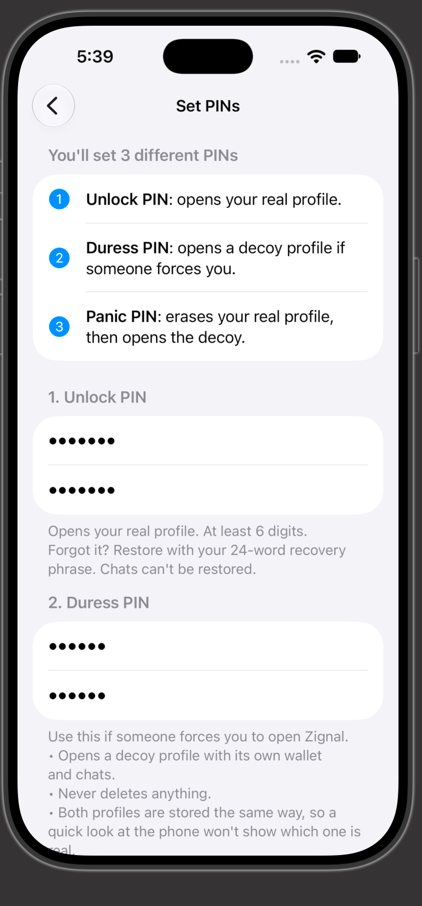
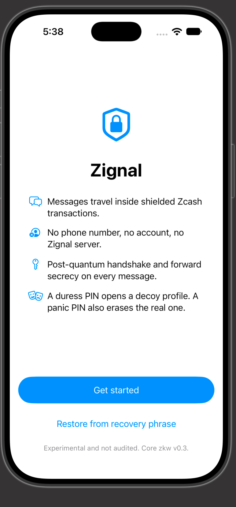

# Zignal

End-to-end encrypted messaging carried inside Zcash shielded transactions.

Two iPhones exchange a single-use QR invite. From then on, every message is one shielded
transaction on Zcash mainnet. There is no Zignal server, no account and no phone number.

On top of Zcash's own memo encryption, Zignal adds a post-quantum hybrid handshake and a
Double Ratchet. A leaked wallet viewing key reveals neither past messages nor who sent them.

> **Status:** experimental, built for the Zecathon (October 2026). Not audited.
> It runs on Zcash mainnet with real ZEC, so use small amounts.

## Screenshots

<p>
  
  
  
</p>

From the iOS simulator: the welcome screen; the three PINs (unlock, duress for the decoy
profile, panic to erase the real profile); and the panic PIN, which must be confirmed as
something that can't be undone.

## What works today

- **Real messages on mainnet:** each profile has its own Zcash wallet. Messages go out as
  shielded transactions and arrive on the other phone after about one block plus a sync.
- **Invites:** show a single-use QR code on one phone, scan or paste it on the other, and send
  a first message. Each contact gets a fresh shielded address.
- **Delivery status:** sending, sent, delivered (in a block), or not sent, with tap to resend.
- **Wallet:** balance and sync status, Add funds (QR code of a shielded address), "Prepare for
  chatting" (splits the balance so several messages can go out in a row), and network
  settings (server list and a Tor switch).
- **Messaging core (Rust):** memo envelope, hybrid post-quantum handshake, Double Ratchet,
  inbox, replay protection, encrypted save and restore, three-PIN vault. Checked byte for byte
  against an independent Python reference.
- **Phone security:** an unlock PIN, a duress PIN that opens a working decoy profile with its
  own wallet, and a panic PIN that silently erases the real profile and opens the decoy. A
  24-word recovery phrase per profile, encrypted storage, lock on background, contact
  verification by safety number.
- **Demo contact:** a contact that lives on the phone and needs no ZEC. It runs the same
  protocol (handshake, ratchet, 512-byte memos) but never touches the network.

## How Zignal differs from a Zcash wallet

Wallets such as ZODL, Zingo, Ywallet or Cake are built for payments; their memo is a note
attached to a payment. Zignal is built for messages, and ZEC only pays the network fees.

| | A memo in a Zcash wallet | A Zignal message |
|---|---|---|
| Who can read it | Anyone with the recipient's viewing key, past and future memos alike | A viewing key shows only ciphertext: a second end-to-end layer with forward secrecy |
| Who sent it | No proven sender: anyone can write any name in a memo | Every contact is authenticated in the handshake; safety numbers to compare |
| Quantum | Zcash's note encryption uses classical cryptography | Hybrid post-quantum handshake (X25519 + ML-KEM-768) inside the memos |
| Addresses | You hand out your wallet address | A fresh shielded address per contact; no transparent addresses |
| Conversation | Shown with each transaction | A chat per contact, delivery status, long messages split across memos |
| On the phone | PIN or Face ID | Duress PIN with a working decoy wallet; panic PIN that erases the real profile |
| Wallet features | Full: any address type, transparent funds, often swaps | Deliberately minimal and shielded-only: enough to fund your messages |

Zignal doesn't yet show plain-text memos that other wallets attach to the ZEC they send you;
that's on the roadmap.

## Try it

- **TestFlight:** pending Apple Developer approval. Until then, build from source with Xcode
  (see Build and test); a free Apple ID can install it on your own iPhone.
- **Two iPhones:** on each, set PINs and back up the recovery phrase, then fund the wallet
  with about 0.01 ZEC (Add funds). Received ZEC can be spent after 10 confirmations.
  Receiving messages needs no ZEC: the sender pays the network fee.
  Zignal only uses shielded addresses: to fund it from an exchange, withdraw to a wallet that
  accepts transparent deposits (such as ZODL), shield there, then send to Zignal.
  On one phone: New chat > Show my invite. On the other: New chat > Scan or paste an invite,
  then write a first message.
- **One iPhone, on chain:** set up and fund both profiles, then in one profile New chat >
  Show my invite > Copy invite, and in the other New chat > Scan or paste an invite > Paste.
- **One iPhone, no ZEC:** use the demo contact (New chat > Start demo chat) to see the full
  protocol without touching the network.
- **Tested on:** iPhone 16 Pro, iOS 27, Zcash mainnet: invites by paste, messages both ways
  with delivery status, safety numbers, Tor on and off.

## Repository layout

| Path | What it is |
|---|---|
| `zkw-core/` | Rust messaging core: memo envelope, handshake, Double Ratchet, inbox, persistence, PIN vault |
| `zkw-ref/` | Python reference implementation and test vectors (the protocol's ground truth) |
| `zkw-ffi/` | Swift bindings for `zkw-core` (UniFFI) and the iOS XCFramework build script |
| `ios/Zignal/` | SwiftUI iOS app: `Core/` (storage, vault, sessions, wallet), `UI/` (screens), `Generated/` (bindings) |
| `ios/Zignal/scripts/` | Downloads and hash-checks the Zcash Sapling parameters bundled into the app |
| `vendor/zcash-swift-wallet-sdk/` | Zcash Swift SDK 3.0.0 (MIT) with two fixes, see `ZIGNAL-PATCHES.md` there |

## Protocol at a glance

- **Transport:** one shielded Zcash transaction per message. Each 512-byte memo is a
  zero-value output to the contact's address, so the recipient never receives dust. Long
  messages use up to 15 memos in the same transaction (ZIP-321 multi-output).
- **Envelope:**
  - Fixed 512 bytes: a 25-byte header, up to 402 bytes of text per memo, and random padding.
  - The first byte is `0xFF`, which marks the memo as binary data under ZIP-302, so wallets
    never try to read it as text.
  - Receipts and reactions are indistinguishable from text on the wire.
- **Handshake:** PQXDH-style hybrid of X25519 and ML-KEM-768 (FIPS 203), with signed prekeys.
  The initiator's identity is encrypted inside the handshake.
- **Messages:** Double Ratchet with header encryption (forward secrecy and post-compromise
  security).
- **Contacts:** single-use invites by QR code or paste. Each contact gets its own receive
  address. Contacts verify each other with a 60-digit safety number. The core also supports
  cold contact requests that the recipient must accept; the app doesn't offer them yet.
- **Conversation lookup:** a tag that rotates daily instead of any sender identifier.
- **Primitives:** X25519, Ed25519, ML-KEM-768, ChaCha20-Poly1305, HKDF-SHA256, Argon2id,
  all from audited RustCrypto and dalek crates. No custom primitives.

## How the app uses Zcash

- **One wallet per profile.** The real and decoy profiles each have their own wallet, derived
  from that profile's 24-word phrase (BIP-39). The phrase restores the wallet and identity,
  not chat history.
- **Shielded only.** Addresses have a single Orchard receiver, and a new one is made for every
  contact and every invite, so contacts can't link you across chats. No transparent address
  is ever shown or used. Since NU6.3, these payments land in the Ironwood shielded pool.
- **Fees:** standard ZIP-317 fees, 0.0001 ZEC for a one-memo message. Fees are public and
  reveal roughly how many memos a transaction carried.
- **Receiving:** after each sync, new transactions are read in chain order, each at its own
  block time, so a message read days later still finds its chat.
- **Delivered** means the transaction is in a block. There are no read receipts, which would
  cost the reader a transaction and reveal when they read.
- **Servers:** public lightwalletd servers by default (zec.rocks and zcash-infra), editable in
  the app, including your own. Tor is off by default and can be switched on per profile.
- **Sapling parameters** are bundled in the app and checked against pinned hashes at build
  time, so the app never downloads them.
- **Patched SDK:** the app builds against a copy of the Zcash Swift SDK 3.0.0 in `vendor/`,
  with the same prebuilt Rust library as the release. It fixes two bugs in the released SDK
  that kept a locked wallet working in the background until the app was closed: stopping a
  wallet while it was syncing could be undone by the SDK's own retry timer, and every sync
  started another mempool watcher that stopping didn't end (each kept a server connection
  open and could recreate a deleted wallet database). With the fixes, a stopped wallet stays
  stopped. Details in `vendor/zcash-swift-wallet-sdk/ZIGNAL-PATCHES.md`; both are reported
  upstream in [zcash/zcash-swift-wallet-sdk#2012](https://github.com/zcash/zcash-swift-wallet-sdk/issues/2012).

## How the app protects data on the phone

**PINs**
- Your unlock, duress and panic PINs each open one slot in a fixed-size, three-slot vault
  (Argon2id, 64 MiB). Each attempt runs Argon2id once and then tries every slot, so all three
  PINs take the same time and nothing on disk says which slot is which.
- The vault is stored in the Keychain, readable only while the phone is unlocked, and never
  synced or moved to another device.
- Wrong PINs trigger a growing wait, shown as a live countdown, and force-quitting the app
  doesn't reset the count.

**Duress and panic**
- The duress PIN opens a decoy profile that looks and works like a normal one, with its own
  wallet. It never erases anything.
- The panic PIN is a last resort. It silently destroys the real profile (its PIN slot, its
  saved data, its wallet files and the Zcash SDK's settings for that wallet), then opens the
  decoy as usual. It first waits for any wallet that is still stopping, so nothing can write
  the real profile's files again after they are deleted. The phone keeps the same number of
  profile files at the same size.
- The app never shows which profile is open.

**Storage**
- Each profile's data is sealed under that profile's own key, inside a second layer sealed
  under a device key.
- Every save rewrites all profile files to one common size with the same timestamps, so the
  files change together whichever profile is in use.
- Data is saved before anything is sent, so a crash can't cause message keys to be reused.
- Profile files and wallet files use complete data protection and are excluded from device
  backups. Wallet file names are derived from each profile's key and don't say which profile
  is which.

**Screen and input**
- The app locks when it goes to the background. Locking stops the profile's wallet: no more
  syncing, network traffic or file writes for that profile until it is unlocked again.
- A cover window hides it, including open sheets and alerts, in the app switcher.
- Third-party keyboards are blocked, and the message box has autocorrect off.
- Received text is shown verbatim, never rendered as Markdown or links.
- Copied invites and addresses stay on this phone (no Universal Clipboard) and clear after
  five minutes.

**Logging and network**
- The app has no logging and no analytics, and the Zcash SDK's logging is turned off.
- Its only network traffic is the wallet talking to the server you choose.

## Build and test

Requirements: macOS with Xcode 27, an iPhone on iOS 17 or later, Rust (`rustup`), and
Python 3.11+ with `cryptography` (reference only).

```bash
# First time only: download the Rust dependencies. The build script then works offline.
(cd zkw-core && cargo fetch) && (cd zkw-ffi && cargo fetch)

# Rust core tests, including byte-for-byte checks against the Python reference
cd zkw-core && cargo test

# Python reference tests
cd zkw-ref && python3 -m unittest -v

# Swift bindings + iOS XCFramework, plus the binding tests
cd zkw-ffi && ./build-ios.sh

# Zcash Sapling parameters (about 51 MB from download.z.cash, size and hash checked)
bash ios/Zignal/scripts/fetch-sapling-params.sh
```

Then open `ios/Zignal/Zignal.xcodeproj`:
- Cmd+U runs the 56 app tests: PIN rules and the wrong-PIN wait, storage encryption and
  tamper checks, the three-PIN vault (duress and panic), what a silent wipe leaves behind,
  recovery phrases, demo chat across restarts, payment request encoding and address checks,
  invite parsing against a real invite from the core, copying an invite as text, memo
  filtering, wallet settings and messages, waiting for stopped wallets, and a timing test for
  each unlock step.
- The Zcash SDK is a local package in `vendor/`. On the first build Xcode downloads its
  dependencies (grpc-swift, SQLite.swift) and the SDK's prebuilt Rust library, checked
  against the checksum in its `Package.swift`.
- Cmd+R runs the app. The wallet connects to the first server in its list.

## Security notes and known limitations

- **Not audited.** Treat as experimental software.
- **On chain:** Zcash shielded transactions hide sender, recipient and amount. Your IP address
  and timing are a separate problem.
- **Network privacy:** with Tor off (the default), the server you use sees your IP address
  and which transactions are yours: the ones you send and the ones it fetches for you to read.
  That links who messaged when to an IP, even though the contents stay encrypted. The Zcash
  SDK's Tor covers sending and fetching; downloading blocks still connects directly. Your own
  server removes the third party entirely.
- **Tor and certificates:** with Tor on, the server's certificate is checked by the Zcash SDK's
  own code, not by iOS. In SDK 3.0.0 that check still trusts eight certificate authorities
  whose keys leaked in October 2026 (iOS itself already blocks them, so Tor off is not
  affected). Someone holding one of those keys and sitting between Tor and the server could
  pose as the server: see which transactions you fetch, hide or fake server data, block sends.
  They can't take funds or read messages. SDK 4.0.0 fixes this; the NU7 update below moves to it.
- **Open app only:** messages arrive while the app is unlocked and synced. There are no push
  notifications, which would need a Zignal server.
- **Cost and delay:** each message costs a normal network fee and arrives after about one block
  plus a sync.
- **Wallet files:** the Zcash SDK stores each wallet in a plaintext database, protected by iOS
  file protection. A forensic image of an unlocked phone could tell which wallet has history.
- **Seed in memory:** while a profile is unlocked, its wallet seed stays in memory to sign
  sends. Swift can't reliably wipe memory after lock; the Rust core wipes its own copies.
- **PIN strength:** a 6-digit PIN can be brute-forced offline by someone who extracts the
  Keychain from an unlocked phone. Use 8 or more digits for real use.
- **Clock:** moving the phone's clock forward shortens the wrong-PIN wait.
- **Decoy realism:** a decoy profile is only convincing if it's used now and then and holds
  a little ZEC.
- **Panic PIN:**
  - It can't be undone. The real wallet's funds come back only with its 24-word phrase, so
    keep that phrase off the phone; chat history can't be recovered.
  - Someone who saw your unlock PIN work before will notice that it stops working.
  - It erases only what's on this phone. Transactions stay on chain (unreadable without the
    keys), the server may keep its own records of your IP address, your contacts keep their
    copies, and the app itself stays installed.
  - Wiping data while being forced to unlock may carry legal risk where you live.
  - A wipe is detectable by someone who knows how Zignal works: two wallets' files normally
    exist, and afterwards only one does.
  - If the app is killed in the instant between wiping the vault slot and deleting the files,
    the real wallet's database stays on the phone (its seed is already gone) until the panic
    PIN is entered again. The duress PIN never deletes anything.
  - If a wallet is still stopping when the panic PIN is entered (for example right after a
    lock during a sync), opening the decoy takes a few seconds longer, at most 15.
- **One phrase, two roles:** a profile's 24-word phrase is both its wallet seed and its
  messaging identity. Anyone with the words can spend the funds and pose as you to your
  contacts with the same safety number, though they can't read past messages.
- **First message of a chat:** forward secrecy for the very first message rests on the weekly
  rotation of signed prekeys; there are no one-time prekeys yet. From the first reply on, the
  Double Ratchet applies.
- **Unused invites** stay valid for about three weeks, and whoever uses one first becomes that
  contact. Compare safety numbers before trusting a chat.
- **NU7:** NU7 activates on mainnet at block 3,543,405 (around November 5, 2026). The Zcash
  Swift SDK this app is built on (3.0.0) can't send after that. ECC's SDK ends support at
  NU7: its final release, 4.0.0, doesn't include NU7, and development continues in the ZODL
  Swift Wallet SDK (AGPLv3). Because Zignal keeps its own patched copy in `vendor/`, it can
  update it itself. A compatibility-only update, changing just the SDK in `vendor/` and the
  code needed to build against it, will be tagged `zecathon-nu7` and pushed to TestFlight:
  either 4.0.0 with Zignal's two fixes and NU7 support added, or the ZODL SDK, decided before
  activation. The Zecathon submission is the `zecathon-final` tag.

## Roadmap (after the Zecathon)

- **TestFlight**, once the Apple Developer account is approved.
- **NU7 compatibility:** an SDK-only update before activation, tagged `zecathon-nu7` (see
  Security notes: ECC's SDK ends at NU7, so Zignal updates its own copy in `vendor/`).
- **Notes from other wallets:** show the text memos that other wallets attach to the ZEC they
  send you, read-only and labelled "sender not verified", with no links.
- **Send to other shielded wallets**, with a plain memo.
- **Import a wallet** into either profile from its 24-word phrase, with a clear warning that
  an existing wallet's history becomes linked to your messaging addresses.
- **Contact requests:** start a chat with any Zignal user from their shielded address, with a
  requests inbox, accept and block, and a small fee for strangers. QR invites stay for meeting
  in person and verifying each other.
- **Hardening from our review:** hide the recovery words while the screen is recorded or
  mirrored, cap stored contact requests, one-time prekeys for the first message, show when a
  contact resets a chat, and let users revoke unused invites.
- **Later:** post-quantum protection for every message (not only the handshake), and Android.

## Development log

All code in this repository was written during the Zecathon build window. Dates match the
git history.

| Date | Commit | Milestone |
|---|---|---|
| 2026-10-06 | `7339654` | Protocol v0.2: Python reference and Rust core with byte-exact test vectors |
| 2026-10-07 | `2ca7515` `3dfc72f` `c208e0b` | Swift bindings (UniFFI), iOS app on the Zcash Swift SDK, encrypted inbox save/restore, Rust core linked into the app |
| 2026-10-08 | `f6273cd` | iOS app: PIN setup, duress unlock, encrypted two-layer profile storage, demo chat |
| 2026-10-10 | `b4c324d` | Protocol v0.3: memos start with `0xFF` (ZIP-302 binary data) |
| 2026-10-18 | `9377c38` | 24-word recovery phrase (BIP-39) backup and restore for each profile |
| 2026-10-19 | `6cbd976` | PIN entry: profiles open off the main thread, live wrong-PIN countdown |
| 2026-10-19 | `df8bd04` | Real messages on mainnet: wallet per profile, invites, sending and receiving, delivery status, network settings |
| 2026-10-24 | `5e24121` | Silent wipe also removes the wiped profile's saved data and wallet files |
| 2026-10-25 | `1ccba0e` | Panic PIN: three-slot vault (v2); duress never erases, panic erases the real profile |
| 2026-10-25 | `7286d05` | Clearer wording on the Set PINs screen |
| 2026-10-26 | `6793b8c` `7b350bf` | Wallets really stop on lock: Zcash SDK 3.0.0 vendored in `vendor/` with two stop bugs fixed; the panic PIN waits for stopped wallets and also removes the SDK's settings for the wiped wallet |
| 2026-10-26 | `2b0b86d` `eb7b148` | README for the patched SDK and the three-PIN vault; MIT OR Apache-2.0 license files |
| 2026-10-27 | `5ec04bb` | Pasting invites works (copied as UTF-8 text), Paste comes first on the add-contact screen, clearer wallet messages |

## Credits

Zignal's own code is everything in this repository except `vendor/`. It builds on these
libraries:

- **Zcash Swift SDK** ([ZcashLightClientKit](https://github.com/zcash/zcash-swift-wallet-sdk),
  MIT, Znewco, Inc. (Zcash Open Development Lab), maintained in the `zcash` GitHub
  organization): wallet sync, keys, addresses and transactions. Release 3.0.0 is
  included in `vendor/` under its own MIT license, with Zignal's two fixes listed in
  `ZIGNAL-PATCHES.md`. It includes **[librustzcash](https://github.com/zcash/librustzcash)**
  (MIT/Apache-2.0).
- **RustCrypto** crates: `ml-kem`, `chacha20poly1305`, `hkdf`, `hmac`, `sha2`, `argon2`.
- **dalek-cryptography**: `x25519-dalek`, `ed25519-dalek`.
- **`bip39`** crate for recovery phrases.
- **[UniFFI](https://github.com/mozilla/uniffi-rs)** (Mozilla, MPL-2.0) for the Swift
  bindings.
- **Python `cryptography`** for the reference implementation.
- **Apple frameworks:** SwiftUI, VisionKit (QR scanning), Core Image (QR codes).
- **Protocol design:** the handshake and ratchet follow the PQXDH and Double Ratchet
  specifications published by Signal. No code was taken from Signal.
- **Public lightwalletd servers** run by zec.rocks and zcash-infra, used as defaults.
- **AI assistance:** built with help from Claude (Anthropic); commits list it as co-author.

## License

Zignal's own code is dual-licensed under either of:
- MIT license ([LICENSE-MIT](LICENSE-MIT))
- Apache License, Version 2.0 ([LICENSE-APACHE](LICENSE-APACHE))

at your option. `vendor/zcash-swift-wallet-sdk/` keeps its own MIT license.
